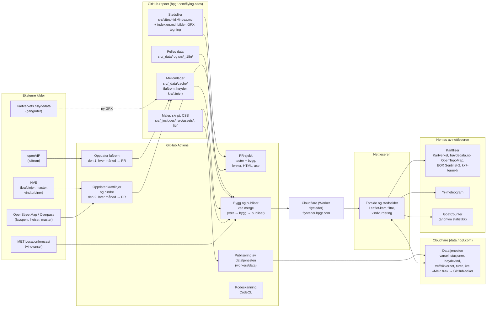
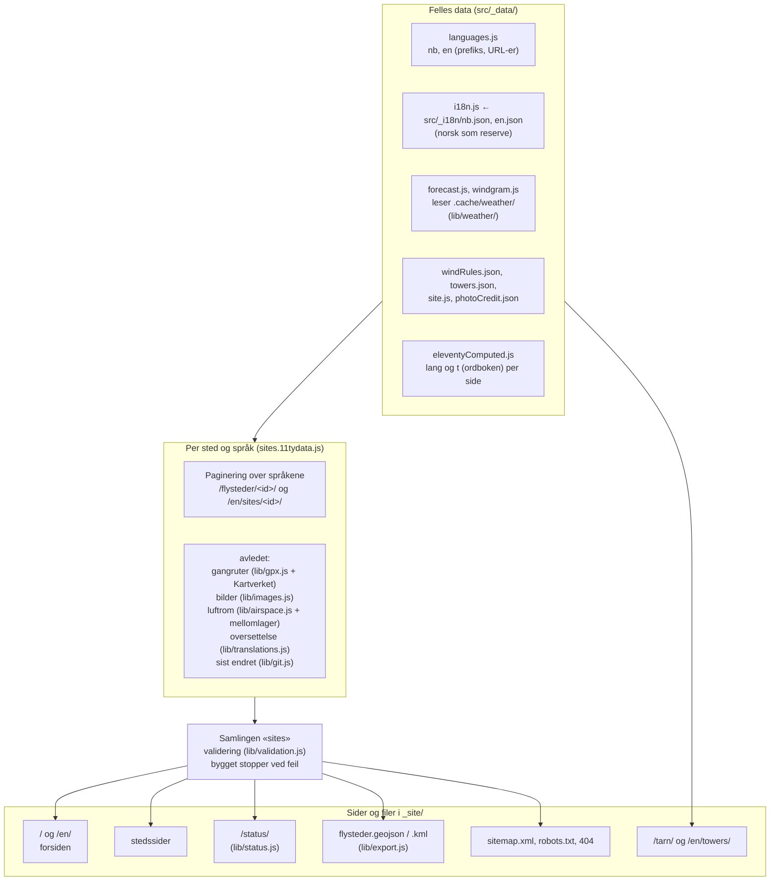
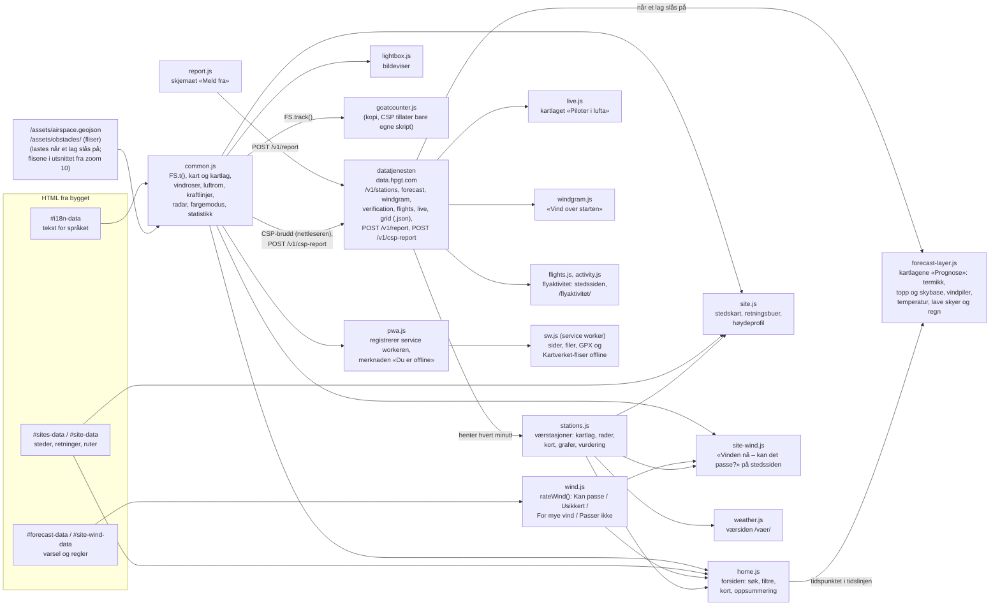
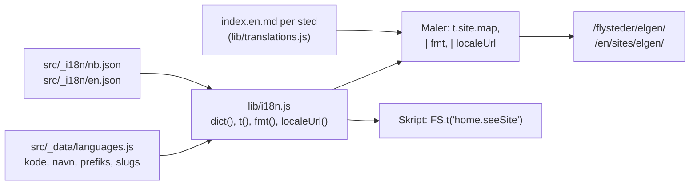
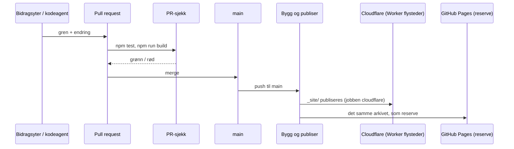
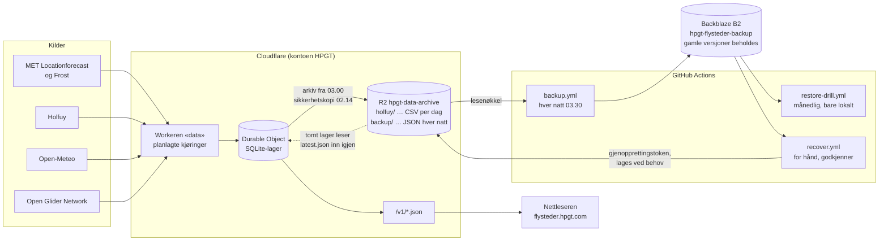
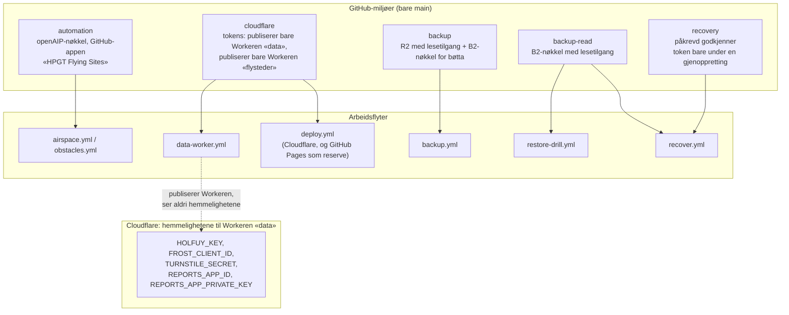

# Arkitektur

Hvordan flysteder.hpgt.com henger sammen: hvor dataene kommer fra, hva som skjer når siden bygges, og hva som kjører
i nettleseren. Diagrammene er Mermaid og vises som diagrammer på GitHub.

Kort sagt: **en statisk side uten server og uten database.** Alt innhold ligger som filer i repoet. GitHub Actions
bygger siden med Eleventy og publiserer den til Cloudflare (med GitHub Pages som reserve) ved hver endring. Data som
må være ferske (vindvarselet, høydevinden, værstasjonene), kommer fra datatjenesten på Cloudflare, som sidene leser
etter lasting. Hvert bygg starter i tillegg fra et varsel som hentes i en egen jobb rett før. Data som er trege å
hente (luftrom, høyder, kraftlinjer), mellomlagres i repoet. Hver type eksterne data er en modul, se
[Datamoduler](#datamoduler).

## Oversikt

Innholdet ligger i repoet og bygges av GitHub Actions, som publiserer til Cloudflare. Luftrom og kraftlinjer hentes
månedlig til mellomlageret som en PR. Nettleseren henter ferske data fra datatjenesten og kartfliser, Yr og statistikk
direkte fra tjenestene.

- **Innholdet er filer.** Hvert flysted er én mappe. Endringer går via en pull request, og PR-sjekken stopper
  ugyldige stedsfiler før de blir publisert.
- **Automatiske importer skriver aldri til stedsfilene**, bare til `src/_data/cache/`. Luftrom kommer som en egen PR
  som gjennomgås.
- **Ferske data fra datatjenesten.** Sidene leser varselet, stasjonene, høydevinden, flyaktiviteten og piloter i
  lufta fra Cloudflare-Workeren etter lasting, og sender «Meld fra» dit. Se [Datamoduler](#datamoduler).
- **Ingen hemmeligheter i nettleseren.** `OPENAIP_API_KEY` brukes bare i arbeidsflyten. Nøklene til datatjenesten
  (`HOLFUY_KEY`, `FROST_CLIENT_ID`, `TURNSTILE_SECRET`, `REPORTS_APP_*`) er hemmeligheter i Cloudflare, aldri i repoet
  eller på sidene.

## Bygget

Eleventy leser dataene i en fast rekkefølge (data cascade) og lager én HTML-side per side og språk.

De felles dataene og hvert sted (per språk) går gjennom valideringen. Fra den gyldige samlingen lages forsiden,
stedssidene, statussiden, de åpne datafilene og sitemap. Tårnsiden lages rett fra de felles dataene.

| Del | Hvor | Hva den gjør |
|---|---|---|
| Stedsdata | `src/sites/<id>/index.md` | Front matter (strukturerte data) og Markdown-tekst. Se [site-files.md](site-files.md). |
| Validering | `lib/validation.js` | Ukjente nøkler, ugyldige retninger, nivåer og kategorier, feil navngitte bilder, manglende gangruter. Feil stopper bygget. |
| Gangruter | `lib/gpx.js` | Lengde, stigning, tid i bevegelse og høydeprofil. Høyder fra Kartverket, mellomlagret per fil i `src/_data/cache/elevations/`. |
| Bilder | `lib/images.js`, `lib/site-images.js` | WebP/JPEG i 400–2400 px uten metadata, med fotograf og lisens innebygd. Bildene finnes ut fra filnavnet. |
| Luftrom | `lib/airspace.js`, `lib/airspace-profile.js`, `scripts/update-airspace.mjs` | openAIP per start, «taket» over starten og høydeprofilen, merknader fra stedsfilen. Kartlaget bruker `region.geojson`. |
| Kraftlinjer og hindre | `lib/obstacles.js`, `scripts/update-obstacles.mjs` | NVEs luftledninger og vindturbiner, og lavspentlinjer, heiser og master fra OpenStreetMap, i området 25 km rundt stedene (NVEs master bare innenfor 1,5 km fra hvert sted), som fliser på 0,25° × 0,5° med en indeks. Kopieres til `/assets/obstacles/` for kartlaget; ingenting beregnes i bygget. |
| Høydevind | `lib/windgram.js`, `lib/weather/open-meteo.js` | Rutenettet til «Vind over starten»: vind for hver 250 m, grenselag, skybase, skyer, regn, sol og vindkast per time. |
| Nytt på siden | `src/_data/news.json`, `src/nytt.njk` | «Nytt på siden» (`/nytt/`): nye funksjoner på begge språk, og planen med lenker til sakene. |
| Vær | `lib/weather/`, `src/_data/forecast.js`, `src/_data/windgram.js` | Fem døgn med vind og nedbør per start fra MET (hver time i omtrent 2½ døgn med vindkast, deretter hver 6. time uten), og høydevind fra Open-Meteo. Leses fra `.cache/weather/`, se [Datamoduler](#datamoduler). Feiler ett sted, mangler bare det stedet. |
| Språk | `lib/i18n.js`, `lib/translations.js` | Ordbøker, URL-er per språk og oversatt stedstekst. Se under. |
| Status | `lib/status.js` | Hva som mangler per sted, til `/status/`. |
| Åpne data | `lib/export.js` | GeoJSON og KML med starter, landinger, parkering og gangruter (CC BY 4.0). |

## I nettleseren

Sidene virker uten JavaScript for det viktigste (tekst, bilder, lenker). Skriptene legger til kart, filtre og
vindvurderingen. Dataene ligger i siden som JSON (`<script type="application/json">`), så skriptene trenger ikke selv
hente noe fra siden.

Dataene i HTML-en leses av `common.js`, `wind.js` og skriptene for forsiden og stedssiden. Stasjoner, høydevind,
turer, piloter i lufta og prognoselagene hentes fra datatjenesten, og «Meld fra» sendes dit. Statistikk går til
GoatCounter, og service workeren gjør sidene tilgjengelige offline.

- **Vindvurderingen** (`wind.js`) er ren logikk uten DOM-tilgang og testes i `test/wind.test.js`. Reglene ligger i
  `src/_data/windRules.json`. Den returnerer både tekst og koder (`gust`, `rain`, `overSiteLimit` …), så forsiden kan
  telle årsaker uavhengig av språk. Vurderingene er «Kan passe», «Usikkert», «For mye vind» og «Passer ikke». Den sier
  aldri «OK å fly».
- **Værstasjoner** (`stations.js`): kontrollene, tekstene og beregningene (endring over en periode, hvor jevn vinden
  er, varselet for et sted fra denne timen, temperaturspennet) er rene funksjoner som testes i
  `test/stations.test.js`. Tegningen bruker bare DOM-metoder, så ingenting fra dataene leses som HTML. Én hentesløyfe
  per adresse deles av alt på en side. Vurderingen av timen nå med en måling (`rateNow` i wind.js) testes i
  `test/wind.test.js`.
- **Kategori og retning henger sammen:** med SPG valgt brukes retningene til startene som er merket SPG
  (`categoryDirections` i `lib/format.js`), i filteret, rosen og vurderingen.
- **Offline og app:** siden kan installeres fra nettleseren (`/manifest.webmanifest`, én per språk). Service workeren
  (`/sw.js`, laget av `src/sw.11ty.js` fra `lib/service-worker.js` og `lib/pwa.js`) lagrer sidene den besøkende åpner,
  sidens egne filer, GPX-filer og Kartverket-flisene som er vist (høyst 300), så et sted som er sjekket hjemme, også
  virker på fjellet. Sider hentes fra nettet først, så varselet er ferskt når det er dekning. Sidene, filene og
  flisene beholdes på tvers av publiseringer: CSS og JS har innholdshashen i URL-en, og når en ny service worker tar
  over, beholder den de gamle versjonene som en lagret side fortsatt bruker, og fjerner resten (`referencedAssets` og
  `staticToKeep` i `lib/pwa.js`). Et sted som er lagret før en publisering, virker derfor offline også etterpå.
  Ingenting lastes ned på forhånd utover forsidene, offline-sidene og skriptene.
- **Hastighet:** Leaflet lastes bare på sidene med kart (`map: true` i front matter: forsiden og stedssidene). På
  stedssiden settes kartet og høydeprofilen opp når de nærmer seg skjermen (`IntersectionObserver` i `site.js`), så
  kartflisene bare hentes når de trengs. Kartets første visning er den tilpassede (`fitWhenVisible` i `common.js`),
  ikke en midlertidig visning først. På mobil beholder forsidekartet størrelsen mens siden ruller, og bare rammen blir
  lavere, så Leaflet ikke tegner det på nytt. Skriptene lastes med `defer` (i rekkefølge, etter at siden er lest inn),
  og OpenTopoMap under Kartverkets kart (for verden utenfor Norge) legges til først når Kartverkets første fliser er
  lastet, så de tregere flisene ikke holder igjen den første visningen (`withUnderlay` i `common.js`). Tre
  fontfiler, alle forhåndslastet. Forsiden åpner forbindelsene til flisserverne tidlig (`preconnect` i front matter).
  Stedssiden holder av plass til «Vinden nå – kan det passe?» til `site-wind.js` har fylt den ut, så boksene under
  ikke hopper.
- **Sikkerhet:** Content-Security-Policy i `base.njk` tillater skript bare fra siden selv (og Cloudflare Turnstile for
  «Meld fra om endring»), og bilder og data bare fra kildene over. En ny ekstern kilde må legges inn der. Som hode
  (`src/headers.njk`) har den også `report-uri` og `report-to`, så nettleserne melder brudd til datatjenesten
  (`POST /v1/csp-report`, `workers/data/src/csp-report.js`), og Trusted Types håndheves, med policyene i
  `src/assets/js/trusted-types.js`. Se [SECURITY.md](../SECURITY.md).

## Språk

Språkene og ordbøkene leses av `lib/i18n.js`, som gir tekst til malene og skriptene. Malene tar i tillegg med den
oversatte stedsteksten og lager én side per språk.

- **Norsk er hovedspråket** og har ikke noe prefiks. Andre språk ligger under eget prefiks (`/en/`), med egne
  URL-navn (`slugs`: `flysteder` → `sites`, `tarn` → `towers`). `localeUrl` oversetter URL-er begge veier og brukes av
  språkvelgeren i menyen, hreflang og sitemap.
- **Fast tekst** (meny, filtre, overskrifter, meldinger i skriptene) ligger i ordbøkene. Det som mangler i et språk,
  hentes fra `nb.json`. `test/i18n.test.js` sjekker at alle oppslag i maler og skript finnes.
- **Stedstekst** oversettes i `index.<språk>.md` ved siden av `index.md`. Bare tekst: koordinater, nivå og retninger
  kommer alltid fra `index.md`. Mangler oversettelsen, vises den norske teksten med en merknad. Statussiden viser steder
  uten oversettelse, og oversettelser som er eldre enn den norske teksten.
- **Nytt språk:** se [operations.md](operations.md#nytt-språk).

## Publisering og arbeidsflyt

En endring går fra en gren via en pull request og PR-sjekken til `main`. En push til `main` starter «Build and
deploy», som publiserer det samme arkivet til Cloudflare og til GitHub Pages som reserve.

| Arbeidsflyt | Når | Hva |
|---|---|---|
| `pr-check.yml` | Hver PR | Tester, ESLint, bygg, lenkesjekk, HTML-validering og sjekken for malfeil som «[object Object]» (`build`); axe, atferdstester og ytelsesbudsjettet i Chromium på noen sider (`accessibility`); tørrkjøring av publiseringen av datatjenesten (`worker`); avhengighetsgjennomgang (pakker med kjente sårbarheter, `dependency-review`) og zizmor (sikkerhet i arbeidsflytene, `workflow-security`). |
| `deploy.yml` | Push til `main`, manuelt | `weather` henter MET og Open-Meteo, `build` bygger med det været og hele Git-historikken (for «Sist endret») og stopper hvis en side har en malfeil som «[object Object]», `cloudflare` publiserer til Cloudflare (flysteder.hpgt.com) med tokenet i miljøet `cloudflare`, `deploy` publiserer det samme arkivet til GitHub Pages som reserve, og `attest` signerer byggeprovenance og en SBOM for arkivet (se [SECURITY.md](../SECURITY.md#verifisere-en-publisering)). `alert` åpner en sak når en jobb feiler. |
| `data-worker.yml` | Push til `main` når datatjenesten, MET-koden eller stedene endres, manuelt | Publiserer datatjenesten (`workers/data`) til Cloudflare Workers, med tokenet i miljøet `cloudflare` (bare `main`). Ruller tilbake til forrige versjon hvis den nye ikke kjører, og åpner en sak når jobben feiler. |
| `airspace.yml` | Den 1. hver måned, manuelt | Henter luftrom fra openAIP og åpner en PR hvis noe er endret. |
| `obstacles.yml` | Den 2. hver måned, manuelt | Henter kraftlinjer og hindre fra NVE og OpenStreetMap og åpner en PR hvis noe er endret. Ingen hemmeligheter. |
| `code-scanning.yml` | PR, push, mandager | CodeQL (sikkerhetsfeil i koden). |
| `health.yml` | Hver time, manuelt | Sjekker datatjenesten utenfra (`/v1/status.json`) og åpner en sak når et datasett er for gammelt eller tjenesten ikke svarer, og lukker den når alt er i orden igjen. |
| `scorecard.yml` | Push til `main`, mandager, endringer i grenbeskyttelsen | OpenSSF Scorecard (god praksis for forsyningskjeden). Resultatene ligger i Code scanning og bak merket i README. |
| `zap.yml` | Den 3. hver måned, manuelt, PR som endrer filen | Passiv sikkerhetsskanning av den publiserte siden med OWASP ZAP (baseline). Rapporten er en artefakt på kjøringen. Ingen saker og ingen token. |
| `backup.yml` | Hver natt kl. 03.30 UTC, manuelt | Kopierer hele arkivbøtta i R2 til Backblaze B2, kontrollerer kopien, og lagrer sakene (hver natt) og Git-historikken (søndager). Miljøet `backup`. |
| `restore-drill.yml` | Den 1. hver måned, manuelt | Viser at kopien i B2 kan gjenopprettes: kjører datatjenesten lokalt på runneren og sjekker at den leser inn igjen hver rad. Rører ingenting i Cloudflare. |
| `recover.yml` | Bare manuelt | Katastrofegjenoppretting: skriver arkivet tilbake til R2, publiserer datatjenesten og kontrollerer gjenopprettingen. Miljøet `recovery` (påkrevd godkjenner, vanligvis uten token). |
| `browser-cache.yml` | Endringer i `package-lock.json` på `main`, manuelt | Fyller Playwright-nettleserens mellomlager som PR-sjekkens jobb `accessibility` bruker. Ingen hemmeligheter. |
| `dependabot-automerge.yml` | PR-er fra Dependabot | Slår på automatisk merge for patch- og minor-oppdateringer av npm-pakker og Actions (også Wrangler), med et token fra GitHub-appen, så merge starter publiseringen. |
| Dependabot | Månedlig | PR-er med oppdaterte pakker og Actions, 7 dager etter en utgivelse (30 for major). |

## Datamoduler

Eksterne data er delt i moduler. Hver modul har én oppgave: hente fra kilden, skrive filer i et fast format, og la
siden lese filene. Malene henter aldri noe selv, så en modul kan endre hvordan eller hvor den henter, uten at siden
merker det.

| Modul | Kilde | Kode | Hentes | Lagres i | Leses av |
|---|---|---|---|---|---|
| Luftrom | openAIP (nøkkel) | `lib/airspace.js`, `scripts/update-airspace.mjs` (`npm run airspace`) | `airspace.yml`, den 1. hver måned, som PR | `src/_data/cache/airspace/` (committet) | `sites.11tydata.js`, kartlaget |
| Vær | MET Locationforecast, Open-Meteo | `lib/weather/`, `scripts/fetch-weather.mjs` (`npm run weather`) | Jobben `weather` i `deploy.yml`, før hvert bygg | `.cache/weather/` (artefakt, ikke committet) | `src/_data/forecast.js`, `src/_data/windgram.js` |
| Datatjenesten: varsel | MET Locationforecast | `workers/data/src/sources/forecast.js` (den samme `lib/weather/met.js`) | Hvert 5. minutt, 6 starter per kjøring | Durable Object (SQLite), servert som `https://data.hpgt.com/v1/forecast.json`, med det varselet sa for hver av de siste 6 timene som `past` (`forecast_hours`, beholdes 30 dager) | `home.js` og `site-wind.js`, med én gang og hvert 10. minutt mens siden er synlig (`watchForecast` i `wind.js`); `weather.js` for «Målt mot varslet» |
| Datatjenesten: stasjoner | Holfuy (nøkkelen `HOLFUY_KEY` i Cloudflare): vind, temperatur, luftfuktighet, trykk, regn og andre verdier i `extra` | `workers/data/src/sources/holfuy.js`, feltene i `measurements.js`, stasjonene i `stations.js` | Hvert minutt | Durable Object (SQLite): de siste 7 dagene, servert med de siste 6 timene som `/v1/stations.json`; eldre dager som CSV i R2 (`archive.js`, bøtta `hpgt-data-archive`) | `stations.js` på forsiden (kartlag, Vær-fanen, «Nå»), værsiden og stedssidene (kartlag; «Målt nå» og «Vinden nå – kan det passe?» på stasjonens sted), hentes på nytt hvert minutt |
| Datatjenesten: høydevind | Open-Meteo, for startene i `WINDGRAM_SITES` (Sollifjellet, Sætertinden, Heia, Kilhusåsen, Elgen) | `workers/data/src/sources/windgram.js` (de samme `lib/weather/open-meteo.js` og `lib/windgram.js`) | Hvert 10. minutt, 2 starter per kjøring | Durable Object (SQLite), servert som `https://data.hpgt.com/v1/windgram.json` | `windgram.js` på stedssiden, når det er nyere enn rutenettet i siden (eller siden ikke har noe) |
| Datatjenesten: treffsikkerhet | Varseltimene og målingene som allerede er lagret | `workers/data/src/sources/verify.js`, stedene i `siteLinks()` i `stations.js` | To ganger i timen (:09, :39) | Durable Object (SQLite) `verify_hours`, beholdes et år; de siste 30 dagene som `https://data.hpgt.com/v1/verification.json` | «Målt nå» på stedssiden og «Målt mot varslet» på /vaer/ (`verifyBlock` i `stations.js`) |
| Datatjenesten: piloter i lufta | Open Glider Network (live posisjoner for paraglidere, ODbL), fra OGNs APRS-strøm når live-kartet deres er nede | `workers/data/src/live.js`, `aprs.js` | Ved behov, når noen har «Piloter i lufta» på, hvert 10. sekund; mellomlagret 10 sekunder | De siste 10 minuttene av hvert spor, med stigningen, bare i minnet til lageret, aldri skrevet ned; servert som `https://data.hpgt.com/v1/live.json` | `live.js` på kartene på forsiden og stedssidene |
| Datatjenesten: prognoserutenett | Open-Meteo: temperatur, duggpunkt, vind i 10 m og 925 hPa, grenselag, lave skyer, regn, solskinn | `workers/data/src/sources/grid.js`, bygget i lageret (`Store.refreshGrid`) | `grid` (0,1 × 0,25°, rundt stedene) hver 3. time kl. :21, `grid-wide` (0,2 × 0,5°, Saltfjellet–Tromsø–Kiruna) hver 6. time kl. :51 | Durable Object, servert som `https://data.hpgt.com/v1/grid.json` og `/v1/grid-wide.json`: dagtimene (04–20 UTC) for de neste dagene | `forecast-layer.js`: kartlagene «Prognose» på forsiden |
| Datatjenesten: sikkerhetskopi | `flight_days` og `verify_hours` i lageret | `workers/data/src/backup.js`, `Store.backup` | Hver natt kl. 02.14 UTC | R2 `backup/<table>/<day>.json` og `latest.json`, 90 dager; et nytt, tomt lager leser inn igjen `latest.json` | Bare ved gjenoppretting |
| Datatjenesten: status | Tjenestens egne kjøringer og datasett | `workers/data/src/health.js` | Hver planlagte kjøring registrerer hvilke kilder som kjørte og hvordan det gikk | Durable Object-tilstanden `health`, servert som `https://data.hpgt.com/v1/status.json` med alderen på hvert datasett mot grensen, startene som mangler og siste arkiverte dag | `health.yml` hver time |
| Datatjenesten: flyaktivitet | Open Glider Network (som over) | `workers/data/src/sources/flights.js` | Hvert minutt | Per sted og dag turene, pilotene, minutter i lufta, lengst og høyest (`flight_days`, beholdes); dagens piloter med en saltet nøkkel som kastes neste dag; servert som `https://data.hpgt.com/v1/flights.json` | `flights.js` på stedssiden, `activity.js` på /flyaktivitet/ |
| Datatjenesten: METs stasjoner | MET Frost (klient-ID `FROST_CLIENT_ID` i Cloudflare): stasjonene innenfor 50 km fra en start (Lofoten til Bardu), funnet én gang i døgnet | `workers/data/src/sources/frost.js` | Hvert 10. minutt | Som Holfuy-stasjonene (kilde `met`), servert i `/v1/stations.json` sammen med dem (`merge.js`) | Som Holfuy-stasjonene |
| Kraftlinjer og hindre | NVE Nettanlegg og Vindkraft (`kart.nve.no`, NLOD), OpenStreetMap via Overpass (ODbL) | `lib/obstacles.js`, `scripts/update-obstacles.mjs` (`npm run obstacles`) | `obstacles.yml`, den 2. hver måned, som PR | `src/_data/cache/obstacles/` (`index.json` og `tiles/<row>_<column>.geojson`, committet, ett objekt per linje) | Kartlaget «Kraftlinjer og hindre» (`addObstacleLayer` i `common.js`) |
| Høyder | Kartverkets høydedata | `lib/gpx.js` | I bygget, bare for nye eller endrede GPX-filer | `src/_data/cache/elevations/` (committet) | `sites.11tydata.js` |
| Bilder | Stedsmappene | `lib/images.js`, `lib/site-images.js` | I bygget | `_site/img/` (mellomlagret i CI) | Stedssidene |

- **Committet eller ikke:** data som endres sjelden og bør gjennomgås (luftrom, kraftlinjer), committes og kommer som
  en PR. Data som bare gjelder noen timer (vær), committes aldri.
- **Feil:** en modul som feiler, utelater sin egen del, ikke hele siden. En værkilde som feiler, skrives som `null`,
  og siden bygges uten vindvurdering eller høydevind.
- **Lokalt** henter `npm start` været selv når `.cache/weather/` mangler eller er eldre enn 30 minutter. I CI leser
  bygget bare filene (`WEATHER_FETCH=0`), og PR-sjekken hopper over været (`FORECAST_OFFLINE=1`).
- **Felles kode:** `lib/site-files.js` leser front matter for alle steder til skriptene.
- **Datatjenesten** (`workers/data`): én Cloudflare Worker med én modul per kilde i `src/sources/`. Hver modul henter
  kilden sin, kontrollerer og konverterer dataene og lagrer datasettet. Alle datasett serveres på samme måte, som
  `/v1/<dataset>.json`, med samme ramme (`dataset`, `source`, `fetched`, og `license` der kildens vilkår krever det,
  deretter datasettets egne felter), og en kilde som feiler, stopper ikke de andre. Én tidsplan kjører hvert minutt,
  og hver kilde har sitt eget intervall (`src/schedule.js`: Holfuy og flyaktiviteten hvert minutt, varselet hvert 5.,
  METs stasjoner og høydevinden hvert 10., treffsikkerheten hvert 30., på ulike minutter så de tyngste kildene aldri
  deler de 10 ms CPU-tid en kjøring har; piloter i lufta hentes ved behov). Lageret er ett Durable Object med SQLite
  (`src/store.js`): gratisplanen tillater langt flere skrivinger per døgn der enn i KV (1000). Varmt og kaldt: lageret
  har de siste 7 dagene for sidene; eldre dager går til arkivet i R2 som én CSV per stasjon per dag, lagt opp for å
  lastes inn i en database senere (stasjonen i hver rad, mappene `station=…/year=…`), og ingenting slettes før det er
  arkivert (`src/archive.js`).
- **Varselet i datatjenesten:** siden bygges bare når innholdet endres, så varselet som er bygget inn i sidene, kan
  være timer gammelt. Datatjenesten henter MET selv, og sidene bruker varselet derfra når det er nyere og velformet
  (timene i rekkefølge, uten gjentakelser; `isNewerForecast` i `wind.js`). De henter det med én gang, hvert 10. minutt
  mens siden er synlig, og når siden blir synlig igjen eller kommer på nett (`watchForecast`). En start som mangler i
  det, får bare ingen vurdering; stedssiden tar det bare i bruk når det har stedets egen start (eller siden ikke har et
  brukbart varsel). En side som er bygget uten varsel, får ett på denne måten. Det gir også vurderingen tilbake når
  sidens eget varsel er blitt for gammelt. Gratisplanen gir 10 ms CPU-tid per kjøring, så hver kjøring henter de 6
  startene som ble forsøkt for lengst siden (et mislykket forsøk teller, så starter som feiler gang på gang, havner
  bakerst i køen), og hele varselet fornyes omtrent hver halvtime.
- **Høydevinden i datatjenesten:** det samme rutenettet som byggets, to starter hvert 10. minutt (hver fornyes omtrent
  hver halvtime, og et mislykket forsøk teller som for varselet). Stedssiden spør igjen hvert 10. minutt, utelater et
  rutenett som er eldre enn 12 timer, tegner det som ligger i siden og bytter det ut med tjenestens når det er nyere,
  så delen også virker når bygget ikke har noe.
- **Ingen planlagte bygg:** begge værkildene ligger i datatjenesten, så `deploy.yml` har ingen tidsplan, og siden
  bygges bare når innholdet endres. Jobben `weather` gjør at hvert bygg starter fra et ferskt varsel.

## Datatjeneste, arkiv og sikkerhetskopi

Datatjenesten har det som må være ferskt (varsel, stasjoner, turer) i et Durable Object, arkiverer målingene i R2 og
tar sikkerhetskopi av historikken hver natt. En kopi av alt går til en annen leverandør, og en månedlig øvelse viser
at den kan gjenopprettes.

Workeren «data» henter fra kildene og lagrer i Durable Object-et, som serverer `/v1/*.json` til nettleseren og
skriver arkiv og sikkerhetskopi til R2. `backup.yml` kopierer R2 til Backblaze B2 med en lesenøkkel. Kopien i B2
brukes av den månedlige øvelsen og av `recover.yml`, som skriver tilbake til R2 med et token som bare lages ved
behov. Et tomt lager leser selv inn igjen den siste sikkerhetskopien fra R2.

| Scenario | Hva skjer | Hvor det er beskrevet |
|---|---|---|
| Lageret er tapt | Et nytt, tomt lager leser selv inn `backup/<table>/latest.json` fra R2 | [operations.md](operations.md#katastrofegjenoppretting), scenario 1 |
| R2-bøtta er tapt | Kopier B2 tilbake til R2 (rclone eller `recover.yml`), deretter som over | Scenario 2 |
| Cloudflare-kontoen er tapt | Ny konto, nye tokens, deretter `recover.yml` | Scenario 3 |
| GitHub-repoet er tapt | Push en klone eller bundlen i B2 til et nytt repo | Scenario 4 |

## Miljøer og hemmeligheter

Hver jobb får bare nøklene den trenger, og alle miljøer er begrenset til `main`. Workerens egne hemmeligheter settes i
Cloudflare og aldri i GitHub. Verdiene skrives aldri ned her; se
[operations.md](operations.md#kontoer-og-hemmeligheter) for hvor hver av dem ligger.

Hvert GitHub-miljø gir nøkler til bare de arbeidsflytene som trenger dem: `automation` til luftrom og hindre,
`cloudflare` til publiseringen av datatjenesten og siden, `backup` til sikkerhetskopien, `backup-read` til øvelsen og
gjenopprettingen, og `recovery` til gjenopprettingen. Workerens egne hemmeligheter ligger bare i Cloudflare.

## Beslutninger

Hvorfor siden er bygget slik, og hva som ble valgt fremfor hva, står i beslutningsnotatene (Architecture Decision
Records) i [decisions/](decisions/README.md).

## Funksjoner

Hovedfunksjonene. Detaljene står i [SPEC.md](../SPEC.md).

- **Grunnlaget:** en Eleventy-side, med én fil per sted og validering, en fast sidemal, et Leaflet-kart med
  Kartverket som bakgrunnskart, mørk modus og fargeblindvennlige farger.
- **Forsiden:** kart med vindroser og klynger (på mobil blir det liggende øverst og krymper mens listen ruller), søk,
  filtre for retning, nivå og kategori, et kort for valgt sted, og fanene Flysteder og Vær.
- **Vindvurdering fra MET:** «Kan passe», «Usikkert», «For mye vind» og «Passer ikke» for hver time i varselet (en
  tidslinje på kartet), med en oppsummering som følger filtrene, og «Vinden nå – kan det passe?» med de neste 12
  timene på stedssidene. Slås av når varselet er for gammelt.
- **Stedssidene:** kart med starter, retningsbuer, landinger, parkering, gangruter og nummererte punkter fra
  tegningen, høydeprofil fra Kartverket, farer, luftrom over starten, Yr-meteogram og bildeviser.
- **Data og kvalitet:** høyder fra Kartverket for start, landing og parkering, gjennomgang av flystedene, statussiden
  med kontroll av manglende innhold, og åpne data (GeoJSON/KML).
- **Luftrom:** openAIP-lag på kartet (CTA/TMA, CTR, militære områder, fare- og restriksjonsområder) med feilmelding
  og «Prøv igjen», månedlig oppdatering via PR, og tårnsiden.
- **Bilder:** import med faste navn, nedskalering, og fotograf og lisens i metadataene.
- **Deling og statistikk:** forhåndsvisning på Facebook og Messenger, sitemap og hreflang, anonym statistikk med
  GoatCounter (sider og klikk, uten informasjonskapsler).
- **Språk:** norsk og engelsk, med engelsk tekst for alle steder, og en struktur for flere språk.
- **Datatjenesten og værstasjoner:** MET-varselet og klubbens Holfuy-stasjoner på Cloudflare (Durable Object, arkiv
  i R2). Stasjonene på kartene, i Vær-fanen og på værsiden `/vaer/` (endring over en periode, hvor jevn vinden er,
  grafer med temperatur, «Målt mot varslet»), blokken «Målt nå» på stasjonens stedsside, og vurderingen av timen nå
  fra en fersk måling. METs egne stasjoner (Frost) på de samme kartene, og «Hvor godt treffer varselet her?» fra
  varseltimene mot målingene.
- **Høydevind:** «Vind over starten», et vindgram med vind for hver 250 m, termikken som en linje og toppen av
  termikken i moh., skybase, vindkast, skyer og regn, fra Open-Meteo, i bygget og i datatjenesten.
- **Open Glider Network (beta):** «Piloter i lufta», paraglidere live på kartene med et spor farget etter stigning og
  synk, og flyaktivitet per sted (stedssiden og `/flyaktivitet/`), telt fra de samme dataene.
- **«Meld fra»:** et skjema på stedssidene og `/meld-fra/` som blir en merket GitHub-sak, med Turnstile og uten
  konto.
- **Kraftlinjer og hindre:** et kartlag med NVEs kraftlinjer og master og lavspentlinjer, heiser og master fra
  OpenStreetMap for hele området rundt stedene, som fliser som lastes for utsnittet, oppdatert månedlig via PR.
- **«Nytt på siden»** (`/nytt/`): hva som er nytt, og planen, for pilotene.
- **Turlogger:** `npm run logbook` summerer IGC- og KML-logger per sted (`lib/igc.js`). Boksen på stedssiden er
  skjult til flere piloter har lagt inn logger.

## Planlagt

- **«Meld fra»:** en agent som oppsummerer saken og gjør endringen som en PR når den er merket `approved`. Sakene
  merkes etter hva de gjelder (`endringsforslag`, `site-data`, `safety`, `bug`, `enhancement`), se
  `workers/data/src/report.js`.
- **Avstand til hindre** på stedssiden, for eksempel «Kraftlinje 63 m fra landing», beregnet i bygget fra
  kraftlinjeflisene.
- **Statistikk fra turlogger** (#105), når flere piloter legger inn logger, eller Flightlog eller pgpilot får et API.
- **NOTAM** som eget kartlag, når det finnes en trygg og tillatt måte å hente fra IPPC på. Det trenger et mellomledd
  på serversiden (datatjenesten), på samme måte som de andre kildene.
- **Glidelinje til landing** på stedssiden: terrengprofil med høyder fra Kartverket langs rett linje fra start til
  landing, med laveste klaring over terrenget. Sammen med et navn per start (`name` i `launches`) kan stedssiden også
  anbefale en start for vinden («Bruk Toppen (S, SØ, Ø)»).
- **Hvor godt varselet treffer, på forsiden:** avviket mellom målt og varslet vind (`/v1/verification.json`) også på
  forsiden, ikke bare på stedssiden og værsiden.
- **Varsel ved flyvindu:** web push fra datatjenesten når et valgt flysted går til «Kan passe» i dagslys. PWA og
  service worker finnes.
- **Delbart «i dag»-bilde** (SVG/PNG fra datatjenesten) for hpgt.com og sosiale medier, siden CSP-en ikke tillater
  innbygging av siden.
- **GitHub-innstillinger i repoet:** rulesettet for `main` eksportert til `.github/rulesets/main.json`, og et skript
  som sjekker innstillingene med `gh api`.
