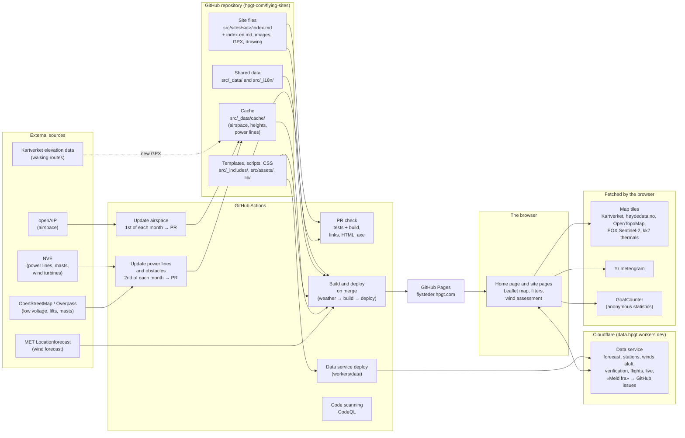
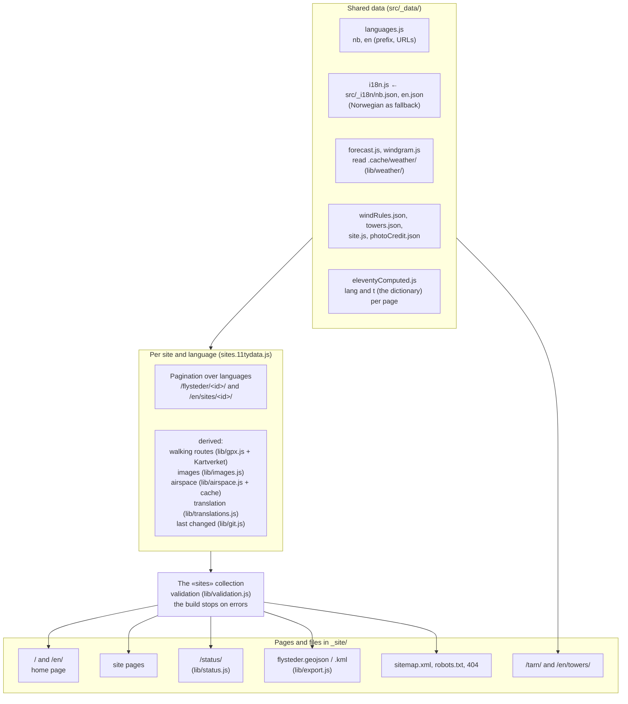
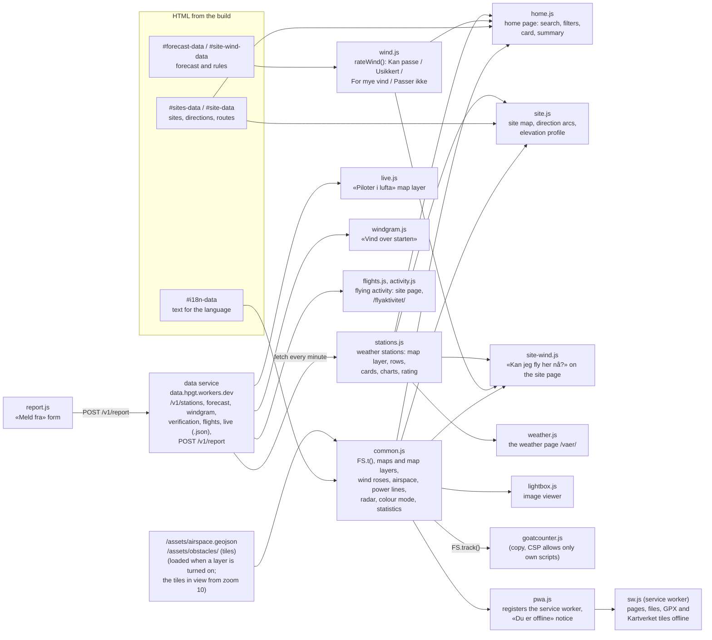
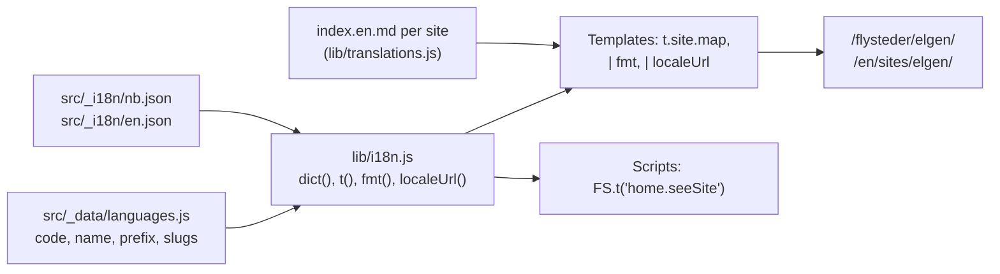
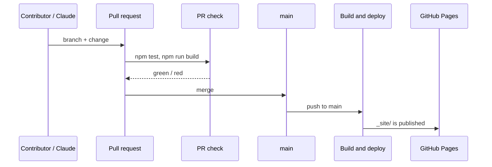

# Architecture

How flysteder.hpgt.com is put together: where the data comes from, what happens when the site is built, and what
runs in the browser. The diagrams are Mermaid and render as diagrams on GitHub.

In short: **a static site with no server and no database.** All content lives as files in the repository. GitHub
Actions builds the site with Eleventy and publishes it to GitHub Pages on every change. Data that must be fresh (the
wind forecast, winds aloft, weather stations) comes from the data service on Cloudflare, which the pages read after
loading; each build also starts from a forecast fetched in its own job just before it. Data that is slow to fetch
(airspace, heights, power lines) is cached in the repository. Each kind of external data is a module, see
[Data modules](#data-modules).

## Overview

- **Content is files.** Each site is one folder. Changes go through a pull request, and the PR check stops invalid
  site files before they go live.
- **Automatic imports never write to the site files**, only to `src/_data/cache/`. Airspace arrives as a separate PR
  that is reviewed.
- **Fresh data from the data service.** The pages read the forecast, stations, winds aloft, flying activity and
  pilots in the air from the Cloudflare Worker after loading, and post «Meld fra» to it. See [Data modules](#data-modules).
- **No secrets in the browser.** `OPENAIP_API_KEY` is used only in the workflow; the data service's keys (`HOLFUY_KEY`,
  `FROST_CLIENT_ID`, `TURNSTILE_SECRET`, `REPORTS_APP_*`) are Cloudflare secrets, never in the repository or the pages.

## The build

Eleventy reads the data in a fixed order (the data cascade) and generates one HTML page per page and language.

| Part | Where | What it does |
|---|---|---|
| Site data | `src/sites/<id>/index.md` | Front matter (structured data) and Markdown text. See [site-files.md](site-files.md). |
| Validation | `lib/validation.js` | Unknown keys, invalid directions, levels and categories, wrongly named images, missing walking routes. Errors stop the build. |
| Walking routes | `lib/gpx.js` | Length, elevation gain, moving time and elevation profile. Heights from Kartverket, cached per file in `src/_data/cache/elevations/`. |
| Images | `lib/images.js`, `lib/site-images.js` | WebP/JPEG at 400–2400 px without metadata, with photographer and licence embedded. Images are found by file name. |
| Airspace | `lib/airspace.js`, `lib/airspace-profile.js`, `scripts/update-airspace.mjs` | openAIP per launch, the "ceiling" above the launch and its height profile, notes from the site file. The map layer uses `region.geojson`. |
| Power lines and obstacles | `lib/obstacles.js`, `scripts/update-obstacles.mjs` | NVE's overhead power lines and wind turbines, and OpenStreetMap's low-voltage lines, lifts and masts, in the region 25 km around the sites (NVE's masts only within 1.5 km of each site), as tiles of 0.25° × 0.5° with an index. Copied to `/assets/obstacles/` for the map layer; nothing is computed at build time. |
| Winds aloft | `lib/windgram.js`, `lib/weather/open-meteo.js` | The grid for «Vind over starten»: wind every 250 m, boundary layer, cloud base, clouds, rain, sun and gusts per hour. |
| What's new | `src/_data/news.json`, `src/nytt.njk` | «Nytt på siden» (`/nytt/`): new features in both languages, and the plan with links to the issues. |
| Weather | `lib/weather/`, `src/_data/forecast.js`, `src/_data/windgram.js` | 48 hours of wind, gusts and precipitation per launch from MET, and winds aloft from Open-Meteo. Read from `.cache/weather/`, see [Data modules](#data-modules). If one site fails, only that site is missing. |
| Languages | `lib/i18n.js`, `lib/translations.js` | Dictionaries, URLs per language and translated site text. See below. |
| Status | `lib/status.js` | What is missing per site, for `/status/`. |
| Open data | `lib/export.js` | GeoJSON and KML with launches, landings, parking and walking routes (CC BY 4.0). |

## In the browser

The pages work without JavaScript for the essentials (text, images, links). The scripts add maps, filters and the
wind assessment. The data is embedded in the page as JSON (`<script type="application/json">`), so the scripts do not
need to fetch anything from the site themselves.

- **The wind assessment** (`wind.js`) is pure logic without DOM access and is tested in `test/wind.test.js`. The rules
  are in `src/_data/windRules.json`. It returns both text and codes (`gust`, `rain`, `overSiteLimit` …), so the home
  page can count reasons independently of language. The ratings are «Kan passe» ("May work"), «Usikkert»
  ("Uncertain"), «For mye vind» ("Too much wind") and «Passer ikke» ("Not suitable"). It never says «OK å fly»
  ("OK to fly").
- **Weather stations** (`stations.js`): the checks, texts and calculations (change over a period, how even the wind
  is, the forecast for a site from this hour, the temperature range) are plain functions tested in
  `test/stations.test.js`; the drawing uses DOM methods only, so nothing from the data is read as HTML. One fetch loop per
  address is shared by everything on a page. The assessment for the hour now with a measurement (`rateNow` in wind.js)
  is tested in `test/wind.test.js`.
- **Category and direction are linked:** with SPG selected, the directions of the launches marked SPG are used
  (`categoryDirections` in `lib/format.js`), in the filter, the rose and the assessment.
- **Offline and app:** the site can be installed from the browser (`/manifest.webmanifest`, one per language). The
  service worker (`/sw.js`, made by `src/sw.11ty.js` from `lib/service-worker.js` and `lib/pwa.js`) stores the pages
  the visitor opens, the site's own files, GPX files and the Kartverket map tiles that have been shown (at most 300),
  so a site checked at home also works on the mountain. Pages are fetched from the network first, so the forecast is
  fresh when there is coverage. The pages, files and tiles are kept across deploys: CSS and JS carry their content hash
  in the URL, and when a new service worker takes over it keeps the old versions a stored page still uses and removes
  the rest (`referencedAssets` and `staticToKeep` in `lib/pwa.js`), so a site stored before a deploy still works
  offline after it. Nothing is downloaded in advance beyond the front pages, the offline pages and the scripts.
- **Speed:** Leaflet is loaded only on the pages with a map (`map: true` in the front matter: the home page and the
  site pages). On the site page the map and the elevation profile are set up when they come near the screen
  (`IntersectionObserver` in `site.js`), so the map tiles are only fetched when they are needed. The map's first view is
  the fitted one (`fitWhenVisible` in `common.js`), not a temporary view first. On mobile the home page map keeps its
  size while the page scrolls, and only its frame gets lower, so Leaflet does not redraw it. Three font files, all
  preloaded. The home page opens the connections to the tile servers early (`preconnect` in the front matter). The
  site page keeps space for «Kan jeg fly her nå?» until `site-wind.js` has filled it in, so the boxes below do not jump.
- **Security:** the Content-Security-Policy in `base.njk` allows scripts only from the site itself (and Cloudflare
  Turnstile for «Meld fra om endring»), and images and
  data only from the sources above. A new external source must be added there. See [SECURITY.md](../SECURITY.md).

## Languages

- **Norwegian is the main language** and has no prefix. Other languages live under their own prefix (`/en/`), with
  their own URL names (`slugs`: `flysteder` → `sites`, `tarn` → `towers`). `localeUrl` translates URLs both ways and
  is used by the language switcher in the menu, hreflang and the sitemap.
- **Fixed text** (menu, filters, headings, script messages) lives in the dictionaries. Anything missing in a language
  falls back to `nb.json`. `test/i18n.test.js` checks that every lookup in templates and scripts exists.
- **Site text** is translated in `index.<language>.md` next to `index.md`. Text only: coordinates, level and
  directions always come from `index.md`. If the translation is missing, the Norwegian text is shown with a notice.
  The status page lists sites without a translation, and translations older than the Norwegian text.
- **New language:** see [operations.md](operations.md#adding-a-language).

## Publishing and workflow

| Workflow | When | What |
|---|---|---|
| `pr-check.yml` | Every PR | Tests, build, link check, HTML validation and the check for template slips such as «[object Object]» (`build`), axe in Chromium on a few pages (`accessibility`), dependency review (packages with known vulnerabilities) and zizmor (workflow security). |
| `deploy.yml` | Push to `main`, manually | Four jobs: `weather` fetches MET and Open-Meteo, `build` builds with that weather and the full Git history (for «Sist endret», "Last changed") and stops if a page has a template slip such as «[object Object]», `deploy` publishes, and `attest` signs build provenance and an SBOM for what was published (see [SECURITY.md](../SECURITY.md#verifying-a-publish)). |
| `data-worker.yml` | Push to `main` when the data service, the MET code or the sites change, manually | Publishes the data service (`workers/data`) to Cloudflare Workers, with the token in the environment `cloudflare` (only `main`). |
| `airspace.yml` | The 1st of each month, manually | Fetches airspace from openAIP and opens a PR if anything has changed. |
| `obstacles.yml` | The 2nd of each month, manually | Fetches power lines and obstacles from NVE and OpenStreetMap and opens a PR if anything has changed. No secrets. |
| `code-scanning.yml` | PR, push, Mondays | CodeQL (security issues in the code). |
| `scorecard.yml` | Push to `main`, Mondays, branch protection changes | OpenSSF Scorecard (supply-chain good practice). Results in Code scanning and behind the README badge. |
| Dependabot | Monthly | PRs with updated packages and Actions. |

## Data modules

External data is split into modules. Each module has one job: fetch from its source, write files in a fixed format,
and let the site read the files. The templates never fetch anything themselves, so a module can change how or where
it fetches (a workflow today, a backend later) without the site noticing.

| Module | Source | Code | Fetched | Stored in | Read by |
|---|---|---|---|---|---|
| Airspace | openAIP (key) | `lib/airspace.js`, `scripts/update-airspace.mjs` (`npm run airspace`) | `airspace.yml`, the 1st of each month, as a PR | `src/_data/cache/airspace/` (committed) | `sites.11tydata.js`, the map layer |
| Weather | MET Locationforecast, Open-Meteo | `lib/weather/`, `scripts/fetch-weather.mjs` (`npm run weather`) | The `weather` job in `deploy.yml`, before every build | `.cache/weather/` (artifact, not committed) | `src/_data/forecast.js`, `src/_data/windgram.js` |
| Data service: forecast | MET Locationforecast | `workers/data/src/sources/forecast.js` (the same `lib/weather/met.js`) | Every 5 minutes, 6 launches per run | Durable Object (SQLite), served as `https://data.hpgt.workers.dev/v1/forecast.json`, with what the forecast said for each of the last 6 hours as `past` (`forecast_hours`, kept 30 days) | `home.js` and `site-wind.js`, at once and every 10 minutes while the page is in view (`watchForecast` in `wind.js`); `weather.js` for «Målt mot varslet» |
| Data service: stations | Holfuy (key `HOLFUY_KEY` in Cloudflare): wind, temperature, humidity, pressure, rain, and other values in `extra` | `workers/data/src/sources/holfuy.js`, fields in `measurements.js`, stations in `stations.js` | Every minute | Durable Object (SQLite): the last 7 days, served with the last 6 hours as `/v1/stations.json`; older days as CSV in R2 (`archive.js`, bucket `hpgt-data-archive`) | `stations.js` on the home page (map layer, Vær tab, «Nå»), the weather page and the site pages (map layer; «Målt nå» and «Kan jeg fly her nå?» on the station's site), refetched every minute |
| Data service: winds aloft | Open-Meteo, for the launches in `WINDGRAM_SITES` (Sollifjellet, Sætertinden, Heia, Kilhusåsen, Elgen) | `workers/data/src/sources/windgram.js` (the same `lib/weather/open-meteo.js` and `lib/windgram.js`) | Every 10 minutes, 2 launches per run | Durable Object (SQLite), served as `https://data.hpgt.workers.dev/v1/windgram.json` | `windgram.js` on the site page, when newer than the grid in the page (or the page has none) |
| Data service: verification | The forecast hours and the measurements already stored | `workers/data/src/sources/verify.js`, the sites in `siteLinks()` in `stations.js` | Twice an hour (:09, :39) | Durable Object (SQLite) `verify_hours`, kept a year; the last 30 days as `https://data.hpgt.workers.dev/v1/verification.json` | «Målt nå» on the site page and «Målt mot varslet» on /vaer/ (`verifyBlock` in `stations.js`) |
| Data service: pilots in the air | Open Glider Network (live positions of paragliders, ODbL) | `workers/data/src/live.js` | On demand, when someone has «Piloter i lufta» on; cached 5 seconds | The last 10 minutes of each track, with the climb, in the store's memory only, never written down; served as `https://data.hpgt.workers.dev/v1/live.json` | `live.js` on the home and site maps |
| Data service: flying activity | Open Glider Network (as above) | `workers/data/src/sources/flights.js` | Every 2 minutes | Per site and day the flights, pilots, minutes in the air, farthest and highest (`flight_days`, kept); the day's pilots by a salted key that is thrown away the next day; served as `https://data.hpgt.workers.dev/v1/flights.json` | `flights.js` on the site page, `activity.js` on /flyaktivitet/ |
| Data service: MET stations | MET Frost (client ID `FROST_CLIENT_ID` in Cloudflare): the stations within 50 km of a launch (Lofoten to Bardu), found once a day | `workers/data/src/sources/frost.js` | Every 10 minutes | As the Holfuy stations (source `met`), served in `/v1/stations.json` together with them (`merge.js`) | As the Holfuy stations |
| Power lines and obstacles | NVE Nettanlegg and Vindkraft (`kart.nve.no`, NLOD), OpenStreetMap via Overpass (ODbL) | `lib/obstacles.js`, `scripts/update-obstacles.mjs` (`npm run obstacles`) | `obstacles.yml`, the 2nd of each month, as a PR | `src/_data/cache/obstacles/` (`index.json` and `tiles/<row>_<column>.geojson`, committed, one feature per line) | The map layer «Kraftlinjer og hindre» (`addObstacleLayer` in `common.js`) |
| Heights | Kartverket elevation data | `lib/gpx.js` | During the build, only for new or changed GPX files | `src/_data/cache/elevations/` (committed) | `sites.11tydata.js` |
| Images | The site folders | `lib/images.js`, `lib/site-images.js` | During the build | `_site/img/` (cached in CI) | The site pages |

- **Committed or not:** data that changes rarely and should be reviewed (airspace, power lines) is committed and arrives as a PR.
  Data that is only valid for a few hours (weather) is never committed.
- **Failure:** a module that fails leaves out its own part, not the whole site. A weather source that fails is
  written as `null`, and the site builds without the wind assessment or winds aloft.
- **Locally**, `npm start` fetches the weather by itself when `.cache/weather/` is missing or older than 30 minutes.
  In CI the build only reads the files (`WEATHER_FETCH=0`), and the PR check skips the weather (`FORECAST_OFFLINE=1`).
- **Shared code:** `lib/site-files.js` reads the front matter of all sites for the scripts.
- **Data service** (`workers/data`): one Cloudflare Worker with one module per source in `src/sources/`. Each module
  fetches its source, checks and converts the data, and stores the dataset. Every dataset is served the same way, as
  `/v1/<dataset>.json`, with the same frame (`dataset`, `source`, `fetched`, and `license` where the source's terms ask for it, then the dataset's own fields),
  and a source that fails does not stop the others. One schedule runs every minute, and each source has its own interval
  (`src/schedule.js`: Holfuy every minute, the flying activity every 2, forecast every 5, MET's stations and winds aloft every 10, the verification every 30, on different minutes so the heavier sources never share an invocation's 10 ms of CPU; pilots in the air are fetched on demand). The store is one Durable Object with SQLite
  (`src/store.js`): the free plan allows far more writes per day there than in KV (1000). Hot and cold: the store keeps
  the last 7 days for the pages; older days go to the archive in R2 as one CSV per station per day, laid out for loading
  into a database later (the station in every row, `station=…/year=…` folders), and nothing is deleted before it is
  archived (`src/archive.js`).
- **Forecast in the data service:** GitHub skips many scheduled runs, so the forecast built into the pages can be hours old. The
  data service fetches MET by itself, and the pages use its forecast when it is newer and well formed (hours in order,
  without repeats; `isNewerForecast` in `wind.js`), fetching it at once, every 10 minutes while the page is in view, and
  when it comes back into view or online (`watchForecast`). A launch missing from it only has no assessment; the site
  page takes it only when it has its own launch (or the page has no usable forecast). A page built without a forecast
  gets one this way too. It also brings the assessment back when the page's forecast has become too old. The free plan
  gives 10 ms of CPU per run, so each run fetches the 6 launches tried longest ago (a failed try counts, so launches that
  keep failing go to the back of the queue), and the whole forecast is renewed about every half hour.
- **Winds aloft in the data service:** the same grid as the build's, two launches every 10 minutes (each renewed about
  every half hour, a failed try counting as for the forecast); the site page asks again every 10 minutes, leaves out a
  grid older than 12 hours, and draws the one
  in the page and replaces it with the service's when that is newer, so the section also works when the build has none.
- **No scheduled builds:** both weather sources are in the data service, so `deploy.yml` has no schedule, and the site
  is built only when the content changes. The `weather` job stays, so each build starts from a fresh forecast.

## What has been built

The main features, roughly in the order they were added. Details are in [SPEC.md](../SPEC.md) and in the PRs.

- **Foundation:** an Eleventy site on GitHub Pages that replaces the old iframe-based guide. One file per site with
  validation, a fixed page template, a Leaflet map with Kartverket as the base map, dark mode and colour-blind-friendly
  colours.
- **Home page:** map with wind roses and clusters (on mobile it stays at the top and shrinks while the list scrolls),
  search, filters for direction, level and category, a card for the selected site, and tabs for Flysteder ("Sites")
  and Vær ("Weather").
- **Wind assessment from MET:** «Kan passe», «Usikkert», «For mye vind» and «Passer ikke» for any hour in the
  forecast (a timeline on the map), with a summary that follows the filters, and «Kan jeg fly her nå?» ("Can I fly
  here now?") with the next 12 hours on the site pages. Turned off when the forecast is too old.
- **Site pages:** map with launches, direction arcs, landings, parking, walking routes and numbered points from the
  drawing, elevation profile from Kartverket, hazards, airspace above the launch, Yr meteogram and image viewer.
- **Data and quality:** Kartverket heights for launch, landing and parking, review of all 32 sites, the status page
  with checks for missing content, open data (GeoJSON/KML).
- **Airspace:** openAIP layer on the map (CTA/TMA, CTR, military areas, danger and restricted areas) with an error
  message and «Prøv igjen» ("Try again"), monthly update via PR, and the towers page.
- **Images:** import with fixed naming, downscaling, and photographer/licence in the metadata.
- **Sharing and statistics:** previews on Facebook/Messenger, sitemap and hreflang, anonymous statistics with
  GoatCounter (pages and clicks, no cookies).
- **Languages:** Norwegian and English, with English text for all sites, and a structure for more languages.
- **Data service and weather stations:** the MET forecast and the club's Holfuy stations on Cloudflare (Durable Object,
  archive in R2). The stations on the maps, in the Vær tab and on the weather page `/vaer/` (change over a period, how
  even the wind is, charts with temperature, «Målt mot varslet»), the «Målt nå» block on the station's site page, and the
  assessment for the hour now from a fresh measurement. MET's own stations (Frost) on the same maps, and «Hvor godt
  treffer varselet her?» from the forecast hours against the measurements.
- **Winds aloft:** «Vind over starten», a windgram with wind every 250 m, the thermals as a line and the top of the
  thermals in m asl, cloud base, gusts, clouds and rain, from Open-Meteo, in the build and in the data service.
- **Open Glider Network (beta):** «Piloter i lufta», paragliders live on the maps with a track coloured by climb and
  sink, and flying activity per site (the site page and `/flyaktivitet/`), counted from the same data.
- **«Meld fra»:** a form on the site pages and `/meld-fra/` that becomes a labelled GitHub issue, with Turnstile and
  no account.
- **Power lines and obstacles:** a map layer with NVE's power lines and masts and OpenStreetMap's low-voltage lines,
  lifts and masts for the whole region around the sites, as tiles loaded for the view, updated monthly via PR.
- **«Nytt på siden»** (`/nytt/`): what is new and the plan, for the pilots.
- **Flight logs:** `npm run logbook` sums IGC/KML logs per site (`lib/igc.js`); the box on the site page is hidden
  until more pilots have added logs.

## Planned

- **Data service** (built): the forecast, the stations, winds aloft, the verification, the flying activity, pilots in
  the air and «Meld fra», all in one Cloudflare Worker, see [Data modules](#data-modules). The Cloudflare account
  «HPGT» is the club's.
- **«Meld fra»** (built): reports become GitHub issues labelled by what they concern (`endringsforslag`, `site-data`,
  `safety`, `bug`, `enhancement`), see `workers/data/src/report.js`. Still planned: an agent that summarises the issue
  and makes the change as a PR once it is labelled `approved`.
- **Distances to obstacles** on the site page, such as «Kraftlinje 63 m fra landing», computed at build time from
  the power line tiles.
- **Statistics from flight logs** (#105), once more pilots add logs or Flightlog/pgpilot get an API.
- **NOTAM** as a separate map layer, once there is a safe and permitted way to fetch from IPPC. It needs a server-side
  intermediary (the data service), the same way as the other sources.
