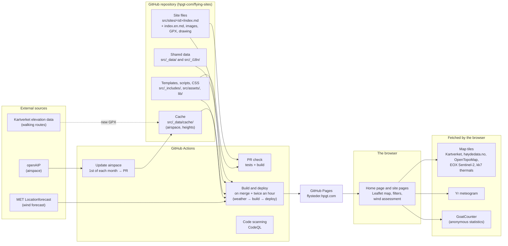
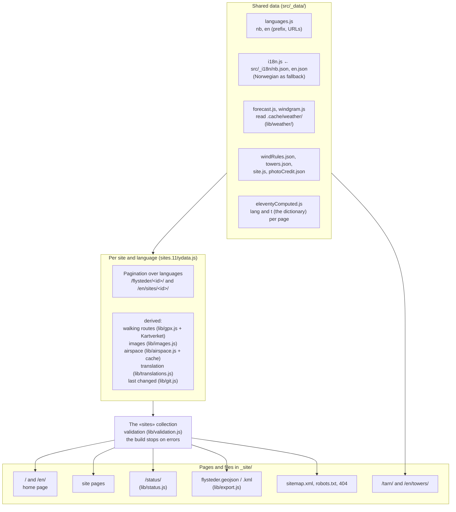
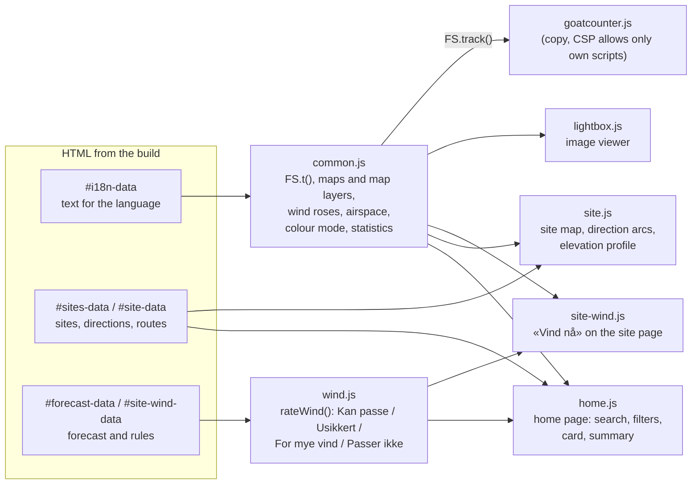
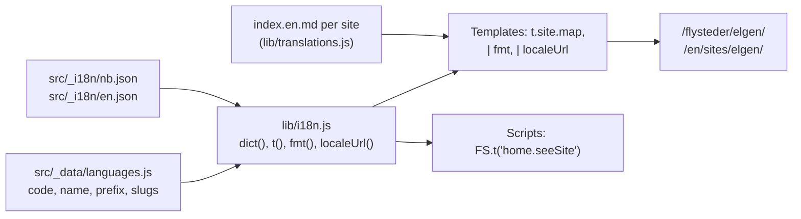
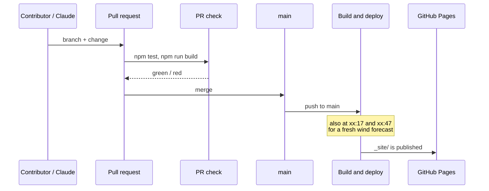
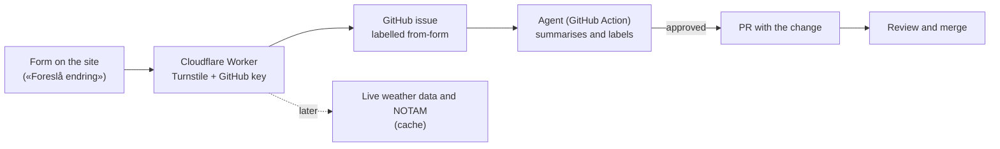

# Architecture

How flysteder.hpgt.com is put together: where the data comes from, what happens when the site is built, and what
runs in the browser. The diagrams are Mermaid and render as diagrams on GitHub.

In short: **a static site with no server and no database.** All content lives as files in the repository. GitHub
Actions builds the site with Eleventy and publishes it to GitHub Pages, twice an hour and on every change. Data that
must be fresh (the wind forecast) is fetched in its own job just before the build. Data that is slow to fetch
(airspace, heights) is cached in the repository. Each kind of external data is a module, see
[Data modules](#data-modules).

## Overview

- **Content is files.** Each site is one folder. Changes go through a pull request, and the PR check stops invalid
  site files before they go live.
- **Automatic imports never write to the site files**, only to `src/_data/cache/`. Airspace arrives as a separate PR
  that is reviewed.
- **No secrets in the browser.** The only key (`OPENAIP_API_KEY`) is used only in the workflow.

## The build

Eleventy reads the data in a fixed order (the data cascade) and generates one HTML page per page and language.

| Part | Where | What it does |
|---|---|---|
| Site data | `src/sites/<id>/index.md` | Front matter (structured data) and Markdown text. See [site-files.md](site-files.md). |
| Validation | `lib/validation.js` | Unknown keys, invalid directions, levels and categories, wrongly named images, missing walking routes. Errors stop the build. |
| Walking routes | `lib/gpx.js` | Length, elevation gain, moving time and elevation profile. Heights from Kartverket, cached per file in `src/_data/cache/elevations/`. |
| Images | `lib/images.js`, `lib/site-images.js` | WebP/JPEG at 400–2400 px without metadata, with photographer and licence embedded. Images are found by file name. |
| Airspace | `lib/airspace.js`, `lib/airspace-profile.js`, `scripts/update-airspace.mjs` | openAIP per launch, the "ceiling" above the launch and its height profile, notes from the site file. The map layer uses `region.geojson`. |
| Weather | `lib/weather/`, `src/_data/forecast.js`, `src/_data/windgram.js` | 48 hours of wind, gusts and precipitation per launch from MET, and winds aloft from Open-Meteo. Read from `.cache/weather/`, see [Data modules](#data-modules). If one site fails, only that site is missing. |
| Languages | `lib/i18n.js`, `lib/translations.js` | Dictionaries, URLs per language and translated site text. See below. |
| Status | `lib/status.js` | What is missing per site, for `/status/`. |
| Open data | `lib/export.js` | GeoJSON and KML with launches, landings, parking and walking routes (CC BY 4.0). |

## In the browser

The pages work without JavaScript for the essentials (text, images, links). The scripts add maps, filters and the
wind assessment. The data is embedded in the page as JSON (`<script type="application/json">`), so the scripts do not
need to fetch anything from the site themselves.

- **The wind assessment** (`wind.js`) is pure logic without DOM access and is tested in `test/wind.test.js`. The rules
  are in `src/_data/windRules.json`. It returns both text and codes (`gust`, `rain`, `overSiteLimit` …), so the home
  page can count reasons independently of language. The ratings are «Kan passe» ("May work"), «Usikkert»
  ("Uncertain"), «For mye vind» ("Too much wind") and «Passer ikke» ("Not suitable"). It never says «OK å fly»
  ("OK to fly").
- **Category and direction are linked:** with SPG selected, the directions of the launches marked SPG are used
  (`categoryDirections` in `lib/format.js`), in the filter, the rose and the assessment.
- **Security:** the Content-Security-Policy in `base.njk` allows scripts only from the site itself, and images and
  data only from the sources above. A new external source must be added there. See [SECURITY.md](../SECURITY.md).

## Languages

- **Norwegian is the main language** and has no prefix. Other languages live under their own prefix (`/en/`), with
  their own URL names (`slugs`: `flysteder` → `sites`, `tarn` → `towers`). `localeUrl` translates URLs both ways and
  is used by the language switcher in the menu, hreflang and the sitemap.
- **Fixed text** (menu, filters, headings, script messages) lives in the dictionaries. Anything missing in a language
  falls back to `nb.json`. `test/i18n.test.js` checks that every lookup in templates and scripts exists.
- **Site text** is translated in `index.<language>.md` next to `index.md`. Text only: coordinates, level and
  directions always come from `index.md`. If the translation is missing, the Norwegian text is shown with a notice.
  The status page lists sites without a translation, and translations older than the Norwegian text.
- **New language:** see [operations.md](operations.md#adding-a-language).

## Publishing and workflow

| Workflow | When | What |
|---|---|---|
| `pr-check.yml` | Every PR | Tests and build (`build`), dependency review (packages with known vulnerabilities) and zizmor (workflow security). |
| `deploy.yml` | Push to `main`, at xx:17 and xx:47, manually | Three jobs: `weather` fetches MET and Open-Meteo, `build` builds with that weather and the full Git history (for «Sist endret», "Last changed"), `deploy` publishes. |
| `airspace.yml` | The 1st of each month, manually | Fetches airspace from openAIP and opens a PR if anything has changed. |
| `code-scanning.yml` | PR, push, Mondays | CodeQL (security issues in the code). |
| Dependabot | Monthly | PRs with updated packages and Actions. |

## Data modules

External data is split into modules. Each module has one job: fetch from its source, write files in a fixed format,
and let the site read the files. The templates never fetch anything themselves, so a module can change how or where
it fetches (a workflow today, a backend later) without the site noticing.

| Module | Source | Code | Fetched | Stored in | Read by |
|---|---|---|---|---|---|
| Airspace | openAIP (key) | `lib/airspace.js`, `scripts/update-airspace.mjs` (`npm run airspace`) | `airspace.yml`, the 1st of each month, as a PR | `src/_data/cache/airspace/` (committed) | `sites.11tydata.js`, the map layer |
| Weather | MET Locationforecast, Open-Meteo | `lib/weather/`, `scripts/fetch-weather.mjs` (`npm run weather`) | The `weather` job in `deploy.yml`, before every build | `.cache/weather/` (artifact, not committed) | `src/_data/forecast.js`, `src/_data/windgram.js` |
| Heights | Kartverket elevation data | `lib/gpx.js` | During the build, only for new or changed GPX files | `src/_data/cache/elevations/` (committed) | `sites.11tydata.js` |
| Images | The site folders | `lib/images.js`, `lib/site-images.js` | During the build | `_site/img/` (cached in CI) | The site pages |

- **Committed or not:** data that changes rarely and should be reviewed (airspace) is committed and arrives as a PR.
  Data that is only valid for a few hours (weather) is never committed.
- **Failure:** a module that fails leaves out its own part, not the whole site. A weather source that fails is
  written as `null`, and the site builds without the wind assessment or winds aloft.
- **Locally**, `npm start` fetches the weather by itself when `.cache/weather/` is missing or older than 30 minutes.
  In CI the build only reads the files (`WEATHER_FETCH=0`), and the PR check skips the weather (`FORECAST_OFFLINE=1`).
- **Shared code:** `lib/site-files.js` reads the front matter of all sites for the scripts.
- **Next step:** when the weather is served from a backend (see [Planned](#planned)), the `weather` job and the
  schedule in `deploy.yml` can go, and the site is only built when the content changes.

## What has been built

The main features, roughly in the order they were added. Details are in [SPEC.md](../SPEC.md) and in the PRs.

- **Foundation:** an Eleventy site on GitHub Pages that replaces the old iframe-based guide. One file per site with
  validation, a fixed page template, a Leaflet map with Kartverket as the base map, dark mode and colour-blind-friendly
  colours.
- **Home page:** map with wind roses and clusters, search, filters for direction, level and category, a card for the
  selected site, and tabs for Flysteder ("Sites"), Vær ("Weather") and Info.
- **Wind assessment from MET:** «Kan passe», «Usikkert», «For mye vind» and «Passer ikke» for now, +3 h, +6 h and
  tomorrow, with a summary that follows the filters, and «Vind nå» ("Wind now") on the site pages. Turned off when the
  forecast is too old.
- **Site pages:** map with launches, direction arcs, landings, parking, walking routes and numbered points from the
  drawing, elevation profile from Kartverket, hazards, facts, airspace above the launch, Yr meteogram and image
  viewer.
- **Data and quality:** Kartverket heights for launch, landing and parking, review of all 32 sites, the status page
  with checks for missing content, open data (GeoJSON/KML).
- **Airspace:** openAIP layer on the map (CTA/TMA, CTR, military areas, danger and restricted areas) with an error
  message and «Prøv igjen» ("Try again"), monthly update via PR, and the towers page.
- **Images:** import with fixed naming, downscaling, and photographer/licence in the metadata.
- **Sharing and statistics:** previews on Facebook/Messenger, sitemap and hreflang, anonymous statistics with
  GoatCounter (pages and clicks, no cookies).
- **Languages:** Norwegian and English, with English text for all sites, and a structure for more languages.

## Planned

- **Change form** without a GitHub account, via a Cloudflare Worker that creates the issue and replies with a link
  to it. An agent summarises the issue, and creates the change as a PR once it is labelled `approved`.
- **Live weather data** from the club's and the model aircraft club's (Modellflyklubben) stations, and **NOTAM** as a
  separate map layer. Both need a server-side intermediary (the same Worker, or Cloudflare Pages Functions if the site
  moves there).
