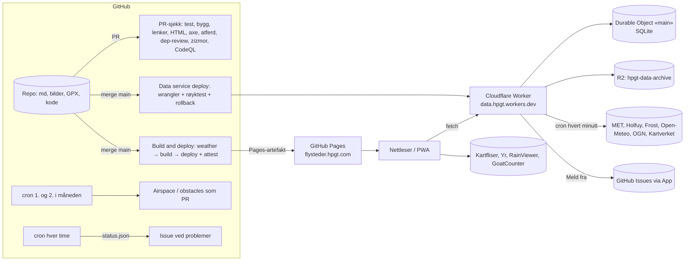

# Review av flysteder.hpgt.com – runde 2

Sett fra en sky- og sikkerhetsarkitekt. Gjennomgått 22.10.2026, mot `main` på `3963e3f`. Forrige review
([REVIEW.md](REVIEW.md), 16.10.2026, `2837c6f`) er lagt til grunn; det som der er merket gjort, er kontrollert og
gjentas ikke, bortsett fra der det har regressert eller fortsatt står åpent.

Grunnlag:

- Koden i repoet: alle sju workflowene, `SECURITY.md`, `docs/`, `lib/`, `scripts/`, `src/assets/js`, malene, og hele
  datatjenesten i `workers/data/src`.
- Lokal kjøring: `npm ci --ignore-scripts`, `npm test` (240 tester, alle grønne), `npm audit` (0 funn i rot og i
  `workers/data`).
- GitHub: kjøringshistorikk for alle workflows, issues, PR-er, grener og collaborators.
- Den publiserte siden: HTTP-headere, TLS, CSP, security.txt, sitemap, 404, alle endepunkter på
  `data.hpgt.workers.dev` (lesende kall pluss to ugyldige POST til `/v1/report`), og Playwright-målinger med
  skjermbilder på desktop, mobil og i mørk modus.
- Ikke testet: DNS utover A/CNAME (CAA, DNSSEC, DMARC – sandkassen blokkerte det), `hpgt-com.github.io`-redirecten,
  Turnstile-flyten med ekte innsending, og Scorecard-API-et. Disse står som «ikke verifisert» der de nevnes.

---

## Kort oppsummert

Siden 16.10. er nesten hele den anbefalte målarkitekturen gjennomført: varselet er ute av byggingen, siden bygges
bare når innholdet endres, datatjenesten på Cloudflare serverer ferske data, bildene caches i CI, airspace-flyten er
delt i lese- og skrivejobb med GitHub App-token, provenance og SBOM signeres, og PR-sjekken kjører lenke-, HTML-, axe-
og nettlesertester. I tillegg har siden fått PWA/offline, en 5-dagers tidslinje, «Meld fra» med Turnstile,
prognoselag, piloter i lufta og flyaktivitet. Det er mye på seks dager, og kvaliteten har holdt: 0 sårbarheter,
240 tester, ingen XSS funnet, ingen informasjonslekkasje fra datatjenesten, alle Actions SHA-pinnet, minste
rettigheter overalt.

**Ingen kritiske funn.** Det som gjenstår er av tre slag:

1. **Mennesker og styring, ikke teknikk.** Én collaborator (admin), én person i CODEOWNERS, Cloudflare-kontoen på en
   privat bruker, og 45 av de siste 50 PR-ene er AI-genererte og merget av samme person som bestilte dem, uten annen
   review. Oppsettet er nå så godt at neste reelle risiko er at én person blir borte, eller at én person godkjenner
   sin egen feil.
2. **Drift gjennom vinteren.** Datatjenesten er ett Durable Object uten reserve ved feil, helsesjekken roper ulv hver
   time (issue #208) og vil bli ignorert, GitHub slår av planlagte jobber etter 60 dager uten commits, og ingenting
   utenfor GitHub overvåker siden. Fri-planen på Cloudflare kan brukes opp av «Piloter i lufta» en travel dag, og da
   stopper hele tjenesten, cron inkludert.
3. **Små herdinger som koster lite.** `style-src 'unsafe-inline'` er ikke lenger nødvendig, HSTS mangler fortsatt,
   secrets ligger utenfor environments, IP-hasher i «Meld fra» slettes først ved neste rapport, og deployen av
   datatjenesten kjører ikke testene.

En uavhengig Grok-review av samme commit kom etter denne; fire av funnene der er bekreftet og tatt inn (OGN-registeret
svarer nå med CSV, App-tokenet er ikke nedskalert, 503 fra live caches ikke, og SPF/DMARC på `hpgt.com` bør
sjekkes), se [Sammenligning](#sammenligning-med-grok-reviewen).

Anbefalt retning: **ingen ny arkitektur.** Bruk neste runde på å få én person til inn, gjøre overvåkingen troverdig,
og ta de små herdingene. Deretter er neste store steg eget domene for datatjenesten (med WAF og rate limiting) og
eventuelt Cloudflare foran GitHub Pages for HTTP-headere.

---

## Status for tiltakene fra 16.10.

| # | Tiltak | Status |
|---|---|---|
| 1 | Varselet ut av byggingen | **Gjort.** `deploy.yml` har ingen cron; datatjenesten serverer varsel, stasjoner og høydevind. |
| 6 | Verifisert domene i organisasjonen, DNSSEC | **Ikke verifisert** (DNS ikke tilgjengelig herfra). Kjør `dig _github-pages-challenge-hpgt-com.hpgt.com TXT` og `dig +dnssec hpgt.com DS`. |
| 11 | Mobil: kart først, tidslinje, flyvindu-stripe | **Delvis.** Kart først og tidslinje er på plass; flyvindu-stripe per sted i listen mangler. |
| 12 | Én vedlikeholder til, «Automatically delete head branches» | **Ikke gjort** for vedlikeholder. Gamle grener er borte (2 grener i dag). |
| – | `.nvmrc`, ESLint/Prettier, `lockfile-lint`, JSON Schema for stedsfiler | **Ikke gjort.** Små ting, tatt med under. |
| – | Sjekklisten i `SECURITY.md` | **Fortsatt ukrysset.** |

---

## Prioritert tiltaksliste

Innsats: XS under 1 time, S noen timer, M 1–3 kvelder, L mer. Alvor gjelder funnet, effekt gjelder tiltaket.

| # | Tiltak | Område | Alvor | Innsats | Effekt |
|---|---|---|---|---|---|
| 1 | Én person til med admin i repo og org, i CODEOWNERS, og Code Owners-review påkrevd for `/.github/**` og `SECURITY.md`. Flytt Cloudflare-eierskapet til en klubbadresse. | Styring | Høy | XS–S | Høy |
| 2 | Ekstern uptime-monitor (gratis, f.eks. UptimeRobot) på `https://flysteder.hpgt.com/` og `/v1/status.json` med nøkkelord, varsel til en klubbadresse. Cloudflare Notifications på Worker-feilrate. | Drift | Middels | XS | Høy |
| 3 | Helsesjekk som ikke roper ulv: meld kildefeil bare når datasettet også er for gammelt eller feilen står i to kjøringer, kommenter bare ved endring, `exit 1` ved problemer. Rett OGN DDB-hentingen: `?j=1` svarer nå 302 til en CSV-fil, koden venter JSON (`aprs.js:18, 124`). | Drift | Middels | S | Høy |
| 4 | try/catch rundt hele `fetch` i datatjenesten: JSON 503 med CORS-headere i stedet for Cloudflares HTML-feilside. | Datatjenesten | Middels | XS | Høy |
| 5 | Backup-status i `status.json` og varsel når siste backup er eldre enn 2 dager. Daglig sletting av «Meld fra»-salt og IP-hasher i backup-kjøringen. | Datatjenesten | Middels | XS | Høy |
| 6 | `npm test` før publisering i `data-worker.yml`, `wrangler deploy --dry-run` i PR-sjekken, røyktest som ikke krever at Holfuy er oppe. | CI/CD | Middels | S | Middels |
| 7 | Workers Paid ($5/mnd), eller 20–30 s poll i «Piloter i lufta». Fjerner kvoterisikoen og 10 ms CPU-grensen. | Drift | Middels | XS | Høy |
| 8 | Fjern de tre `style="…"` i egne HTML-strenger og stram CSP til `style-src 'self'`. | Sikkerhet | Middels | S | Middels |
| 9 | Environment `automation` (bare `main`) for `OPENAIP_API_KEY` og `APP_PRIVATE_KEY`. Nytt Cloudflare-token uten KV, med R2 Read om mulig, og en påminnelse om utløpet 18.10.2027. | Sikkerhet | Middels | XS | Middels |
| 10 | Stale-reserve i cache-laget: server forrige gyldige datasett når Durable Object-et feiler. | Datatjenesten | Middels | S | Høy |
| 11 | `If-Modified-Since` og `Expires` mot MET (vilkårene krever det). | Datatjenesten | Middels | S | Middels |
| 12 | HSTS: enten Cloudflare foran Pages (gir også `frame-ancestors`, `nosniff`, `Permissions-Policy`, brotli og lange cache-tider), eller `includeSubDomains; preload` på `hpgt.com`. Inntil da: frame-buster i `common.js`. | Sikkerhet | Middels | S–M | Middels |
| 13 | `prefers-reduced-motion` i CSS og i `site.js`. | Tilgjengelighet | Middels | XS | Middels |
| 14 | Status og «Prøv igjen» for «Piloter i lufta» når tjenesten er nede (i dag ser det ut som «ingen flyr»). | Korrekthet | Middels | S | Middels |
| 15 | Ikke tegn om hele forsiden ved hvert stasjonssvar (hvert minutt). | Ytelse | Middels | S | Middels |
| 16 | ESLint (flat config, `recommended`) i PR-sjekken; `.nvmrc` + `node-version-file`; `concurrency` på PR-sjekk og code scanning; Scorecard uten `push`. | CI/CD | Lav | XS–S | Middels |
| 17 | Ruleset eksportert til `.github/rulesets/main.json` og et `scripts/check-settings.mjs` som verifiserer GitHub-innstillingene med `gh api`. Kryss av og dater sjekklisten i `SECURITY.md`. | GitOps | Middels | S | Middels |
| 18 | `DAILY_LIMIT` 50 / `PER_IP_LIMIT` 3 for «Meld fra», logg Turnstiles `error-codes`, krev `action: "report"`. | Sikkerhet | Middels | XS–S | Lav |
| 19 | Flyvindu-stripe (24 ruter for i dag) i listeradene på forsiden, og «neste vindu» når ingen passer. | Design | – | S | Høy |
| 20 | Eget domene for datatjenesten (`data.hpgt.com` eller `data.flysteder.hpgt.com`) med WAF-regel for `/v1/report` og rate limiting. | Arkitektur | Lav | M | Middels |
| 21 | SPF, DKIM og DMARC på `hpgt.com` (fra Grok-reviewen, ikke verifisert herfra, se [Sammenligning](#sammenligning-med-grok-reviewen)). Gjelder klubbens e-post, ikke siden, men er det alvorligste funnet hvis det stemmer. | Domene | Høy | XS | Høy |
| 22 | Nedskaler GitHub App-tokenet i `github-app.js:48`: send `repositories` og `permissions: { issues: "write" }` i token-kallet. | Sikkerhet | Lav | XS | Lav |
| 23 | Cache 503-svar fra `/v1/live.json` i 10–30 s (i dag `no-store`, og hver forespørsel lytter 8 s på APRS når OGN er nede). | Datatjenesten | Lav | XS | Middels |
| 24 | Runbook og overlevering i `docs/operations.md`: kompromittert eller utløpt token, Actions nede, Worker-feil, feil deploy, DNS-problem, og hvordan et nytt styre får tilgang til GitHub, Cloudflare og domenet (fra ChatGPT-reviewen). | Drift | Middels | S | Høy |
| 25 | PR-mal med «Hva er endret?», «Berører vind, luftrom eller sikkerhet?», «Testet?» og «Kilde/dato», og `CONTRIBUTING.md` for redaksjonelle endringer. | Styring | Lav | XS | Middels |

Resten av funnene står i de enkelte kapitlene, med lav alvorlighet.

---

## 1. Oppsett og arkitektur

### Slik er det i dag

### Vurdering

**Prinsippet fra forrige review er gjennomført:** Git er sannheten for innhold og kode, edge er sannheten for data.
Byggingen går bare ved endring (222 deployer siden 5.10., men det skyldes høy utviklingstakt, ikke cron), og sidene
henter nyere data fra datatjenesten etter lasting, med innebygde data som reserve. Kontrakten ved utfall er riktig:
tjenesten nede gir eldre varsel og manglende stasjoner, ikke en død side (`src/assets/js/wind.js:94-113`).

**Datatjenesten er ett Durable Object.** Alt (`store.js`, DO «main») er ett objekt på én plassering. Det er riktig
valg for volumet, men det er også ett punkt som kan feile:

- `cache.js` lagrer bare 60 sekunder. Feiler DO-et, er alle datasett borte etter ett minutt, selv om innholdet er
  gyldig i timer (`MAX_AGE` i `health.js`). Tiltak 10: en «stale»-kopi med lang levetid som reserve.
- `index.js:91-125` har ingen try/catch. Kaster DO-et (kvote, overbelastning, SQLite-feil i `transactionSync` ved
  oppstart), svarer Cloudflare med sin HTML-side uten CORS, og nettleseren ser en CORS-feil. Tiltak 4.
- Fri-planen gir 100 000 forespørsler per dag for hele Workeren, cron inkludert. «Piloter i lufta» spør hvert
  10. sekund per seer (`src/assets/js/live.js:15`); noen titalls seere i flere timer bruker opp dagen, og da stopper
  også datainnsamlingen. Tiltak 7. Koden bærer allerede preg av 10 ms CPU-grensen (kommentarer i `schedule.js`,
  `grid.js`, `forecast.js`); Workers Paid fjerner begge begrensningene for $5 i måneden.
- Planen i `schedule.js:19-21` kjører en kilde bare når minuttet stemmer eksakt. Cron Triggers er «best effort»;
  en hoppet kjøring 02:14 betyr ingen backup den dagen. Legg inn «sist kjørt» og kjør når det er lenge nok siden.

**Hosting på GitHub Pages** har de samme begrensningene som sist: ingen egne headere (HSTS, `frame-ancestors`,
`nosniff`, `Permissions-Policy`), `max-age=600` på alt, bare gzip, ingen forhåndsvisning av PR-er. Det er fortsatt
akseptabelt. Hvis dere vil ha headerne uten å flytte hostingen, er Cloudflare foran Pages (DNS-proxy) den minste
endringen: domenet er allerede delvis i Cloudflare-økosystemet, og det gir HSTS, headere via Transform Rules,
brotli og cache-regler i ett grep. Det betyr samtidig at Cloudflare blir en avhengighet for selve siden, ikke bare
for dataene; vurder det bevisst.

**Datatjenesten på `workers.dev`** er bakt inn i CSP, service worker, `health.yml`, røyktesten og
nettlesertestene. Et eget domene (tiltak 20) gir WAF, rate limiting og Cache Rules under klubbens kontroll, og lar
tjenesten flytte uten CSP-endring. `data.hpgt.com` finnes ikke i DNS i dag.

---

## 2. CI/CD, GitOps og DevSecOps

### Tall fra GitHub (22.10.)

| Workflow | Kjøringer | Siste 50 | Varighet |
|---|---|---|---|
| Build and deploy | 222 siden 5.10. (ca. 13 per dag) | 50/50 grønne | ca. 2 min 12 s (build 25 s, deploy-pages 70 s) |
| PR check | 310 | 46 grønne, 4 røde (minst én reell, fra `check:behaviour`) | median 1,4 min |
| Data service | 31 | 31/31 grønne | 1,5–2,5 min inkl. røyktest |
| Data service health | 14 siden 19.10. | 14/14 «grønne», men issue #208 åpent | 10 s |
| Scorecard | 78 (hver push til `main`) | grønne | 45 s |
| Code scanning | 463 | grønne | 1–1,5 min |
| Update airspace | 5, alle manuelle (første planlagte 1.11.) | grønne | – |

Åpne PR-er: 0. Åpne issues: 4. Grener: 2. Collaborators: 1 (admin). Forbruk ca. 40–60 runner-minutter per dag,
gratis for et offentlig repo.

### Det som er bra

- `permissions: {}` eller `contents: read` som standard i alle workflows. Bare `deploy` har `pages`/`id-token`,
  bare `attest` har `attestations`, bare `alert` har `issues: write`. Ingen `pull_request_target`. Alle verdier til
  `run` går via `env`, ingen `${{ }}` i skript.
- Lese- og skrivejobber er skilt med artefakt imellom (`airspace.yml`, `obstacles.yml`). `actions/cache/restore` i
  PR-sjekken, aldri save, så en PR kan ikke forgifte bildecachen til `main`.
- Alle Actions SHA-pinnet med versjonskommentar. Bare to tredjeparts-actions (zizmor, ossf/scorecard).
- `npm ci --ignore-scripts` overalt, `persist-credentials: false` overalt, timeout på alle jobber, `concurrency`
  på Pages og Worker.
- Provenance og SBOM signert per publisering. Worker-deploy med røyktest og automatisk `wrangler rollback`.
- Lockfilene er rene: alle 276 pakker fra `registry.npmjs.org` med `integrity`. Dependabot månedlig, 7 dagers
  cooldown, gruppert. `wrangler` låst til eksakt versjon.
- `SECURITY.md` og `docs/operations.md` er uvanlig presise og har kodehenvisninger som stemmer.

### Funn

**A1. Bus-faktor 1 (Høy).** `CODEOWNERS` har én person, repoet har én collaborator, Cloudflare-kontoen eies av en
privatbruker (`docs/operations.md:410`). Ingen annen kan merge, deploye, lese et issue eller ta over om noe skjer.
Tiltak 1. «Require review from Code Owners» kan begrenses til `/.github/**` og `SECURITY.md` i CODEOWNERS, så
innholds-PR-er ikke bremses.

**A2. AI-generert kode uten annen review (Middels).** 76 av 133 commits i historikken er skrevet av en
AI-assistent, og PR-ene merges av den som bestilte dem. Kvaliteten er høy, men flyten mangler en uavhengig
leser. Billige mottiltak: (a) en `CLAUDE.md` eller `CONTRIBUTING.md` med husregler (språk, hva som alltid skal
testes, hva som aldri skal endres uten diskusjon, f.eks. `windRules.json` og farer i stedsfilene); (b) en regel om
at endringer i sikkerhetsrelevant innhold (farer, luftrom, vindgrenser) alltid leses av én pilot til før merge,
selv om koden ikke gjør det; (c) ESLint som fanger det enkleste (tiltak 16).

**A3. Innstillinger utenfor Git kan ikke verifiseres (Middels).** Ruleset, environments, Actions-innstillinger,
Pages, Turnstile, R2, to GitHub Apps og API-tokenet finnes bare i UI. Sjekklisten i `SECURITY.md:113-144` er
ukrysset. Tiltak 17: eksporter rulesettet som JSON til repoet, og et lite skript som med `gh api` sjekker ruleset,
påkrevde sjekker, Actions-rettigheter, secret scanning og Pages-HTTPS. Terraform er overkill for dette.

**A4. Dokumentasjonsdrift om Cloudflare-tokenet (Middels).** `SECURITY.md:85` nevner Workers Scripts, KV og Tail,
men ikke R2; `wrangler.toml:18-19` krever R2 Edit; `operations.md:415` sier «Workers, KV and R2». Ingen KV-binding
finnes. R2 har ingen versjonering eller papirkurv, så et lekket token med R2 Edit kan slette arkivet. Lag nytt token
med bare det som trengs, prøv R2 Read (bindingen trenger bare at bøtta finnes), og legg inn en månedlig kopi av
arkivet utenfor kontoen (tiltak 9).

**B1. Secrets uten environment (Middels).** `OPENAIP_API_KEY` (`airspace.yml:66`) og `APP_PRIVATE_KEY`
(`airspace.yml:105`, `obstacles.yml:87`) er repo-secrets. `workflow_dispatch` kan kjøres fra en hvilken som helst
gren, så en endret workflow på en gren kan lese dem. Planlagt i `SECURITY.md:79-80`; ti minutters jobb.

**B2. Deployen av datatjenesten kjører ikke testene (Middels).** `data-worker.yml` har verken `npm test` eller
`wrangler deploy --dry-run`. Testene kjører i PR-sjekken, men regelsettet som krever PR er en avkrysningsboks i
`SECURITY.md`. Røyktesten (`scripts/data-smoke.mjs:12-19`) krever at Holfuy lykkes: er Holfuy nede ved deploy,
rulles en god versjon tilbake og det åpnes en falsk feil-issue. Tiltak 6.

**B3. Markdown-injeksjon i issues fra botter (Lav).** `health.yml:34` setter feilmeldinger fra kildene (HTTP-tekst
fra OGN, Holfuy, MET) rått inn i issue-teksten. `obstacles.yml:118` og `airspace.yml:137` legger skriptutdata inne i
et gjerde av tre backticks; en linje med tre backticks i utdata bryter ut. Konsekvensen er lenker eller @-nevnelser i et issue fra botten.
`~~~`-gjerde og `jq @json` på strengene.

**B4. Småting (Lav).** Ingen `concurrency` på `pr-check.yml` og `code-scanning.yml` (tre parallelle kjøringer på
samme gren 21.10.). Scorecard kjører på hver push (78 kjøringer på fem dager); behold `schedule` og
`branch_protection_rule`. `node-version: 22` hardkodet sju steder mens `package.json` krever ≥22.22; `.nvmrc`.
`alert`-jobben er kopiert fire ganger; én reusable workflow. Slettet `codeql.yml` står som aktiv i Actions-lista;
deaktiver. `deploy.yml:122` hasher `$RUNNER_TEMP/artifact.tar`, en intern detalj i `upload-pages-artifact`; kan
ryke ved neste major-bump (attest feiler, deploy går).

**C1. Helsesjekken roper ulv (Middels).** `health.yml` melder en kilde som feilet sist selv når datasettet er
ferskt. Issue #208 har fått én kommentar per time siden 21.10. om forbigående feil (OGN 521, timeouts, OGN DDB som
svarer `#DEVICE_TYPE…` i stedet for JSON). Jobben avslutter alltid med 0, så Actions-historikken er grønn uansett.
Et varsel som alltid går, blir ignorert, og da oppdages ikke den reelle feilen. Tiltak 3. DDB-feilen er en reell bug
i `workers/data/src/aprs.js`-flyten (formatet har trolig endret seg) og bør rettes samtidig.

**C2. Ingen overvåking utenfor GitHub (Middels).** `health.yml` er eneste eksterne sjekk, og GitHub slår av schedule
etter 60 dager uten commits. Om vinteren kan datatjenesten stoppe uten at noen får beskjed, og selve nettsiden
overvåkes ikke i det hele tatt. Tiltak 2.

**D1. Workeren mangler tørrkjøring i PR (Middels).** En feil i `wrangler.toml`, en migrasjon eller et ulovlig
import oppdages først av `wrangler deploy` på `main`, og rulles tilbake. En jobb `worker` i PR-sjekken med
`wrangler deploy --dry-run --outdir` trenger ingen secrets. Tiltak 6.

**D2. Rollback for Pages er ikke dokumentert (Lav).** Workeren har automatisk og manuell rollback. For siden er
svaret «Re-run» på en eldre «Build and deploy»-kjøring, eller `git revert`. To linjer i «Troubleshooting».

**D3. Forhåndsvisning av PR-er (Lav).** PR-sjekken laster opp `_site` uten bilder som artefakt, som en reviewer kan
kjøre lokalt. Cloudflare Pages-preview per PR er mulig, men vent til flere enn én person gjør review.

**E. Scorecard (anslått, ikke verifisert).** Gode: Token-Permissions, Pinned-Dependencies, Dangerous-Workflow, SAST,
Security-Policy, Vulnerabilities, Maintained, Dependency-Update-Tool, License, Binary-Artifacts. Delvis:
Branch-Protection (0 påkrevde godkjenninger, admin-bypass). Lave: Code-Review (alle PR-er merget uten annen
reviewer), Contributors. Code-Review og Branch-Protection er de to som flytter seg med tiltak 1.

**F. Kvalitetsporter som mangler (Middels).** Ingen ESLint, Prettier eller tsconfig. Med så mye AI-skrevet kode er
en minimal ESLint flat config (`recommended`, `no-unused-vars`, `no-undef`) billig forsikring. `// @ts-check` og
`tsc --noEmit` kan komme senere. `scripts/update-airspace.mjs` og `update-obstacles.mjs` har ingen test og kjører
månedlig; en fixture-test av parsing og diff ville fange brudd før den 1.

---

## 3. Sikkerhet

### Siden (målt på flysteder.hpgt.com)

| Kontroll | Status | Kommentar |
|---|---|---|
| HTTP → HTTPS | ✅ 301 | |
| TLS | ✅ | Let's Encrypt, TLS 1.3, h2. Gyldig til 23.12.2026 (Pages fornyer selv). |
| HSTS | ❌ | Pages setter det ikke. `www.hpgt.com` har HSTS uten `includeSubDomains`; med `includeSubDomains; preload` på apex dekkes flysteder også. Tiltak 12. |
| CSP | ✅ meta | `default-src 'self'`, `script-src 'self' challenges.cloudflare.com`, `object-src 'none'`, `base-uri 'self'`, `form-action 'self'`, `upgrade-insecure-requests`. Ingen inline-script kjører. Stram og god. |
| `style-src 'unsafe-inline'` | ⚠️ | Begrunnes med Leaflet, men Leaflet setter stil via CSSOM, som ikke krever det. Det som krever det er tre `style="…"` i egne HTML-strenger: `home.js:216`, `live.js:130`, `stations.js:670`. Sett `el.style` etter innsetting, og stram til `'self'`. Tiltak 8. |
| Clickjacking | ⚠️ | `frame-ancestors` virker ikke i meta, ingen `X-Frame-Options`. Lav risiko (ingen handlinger med konsekvens), men en frame-buster i `common.js` er gratis inntil headere finnes. |
| `X-Content-Type-Options`, `Permissions-Policy` | ❌ | Pages-begrensning. Content-Type er korrekt for alle filtyper (`geo+json`, `kml+xml`, `gpx+xml`, `manifest+json`), så lav risiko. |
| Referrer-Policy | ✅ meta | `strict-origin-when-cross-origin`. |
| XSS | ✅ | 21 `innerHTML`-steder gjennomgått: alt går via `escapeHtml`, tall eller allowlist. Alle eksterne data (datatjenesten, openAIP, NVE/OSM, RainViewer, OGN) valideres mot form før bruk. Ingen `eval`, `Function`, `DOMParser` eller `document.write`. Hash-parametre valideres. Alle `target="_blank"` har `rel="noopener"`. |
| Service worker | ✅ | Bare samme opphav og CORS-svar fra Kartverket lagres, aldri opake. `?v=`-hash og `referencedAssets` løser gammel JS mot ny HTML. |
| security.txt | ✅ | Gyldig, `Expires` 2027-10-21. |
| Tredjeparter | ✅ | Ingen eksterne script, iframes eller stilark. Turnstile lastes først når skjemaet åpnes. |
| 404 | ✅ | Riktig status, `noindex`. |
| Domene | ❓ | Verifisering i organisasjonen, CAA og DNSSEC ikke verifisert herfra. |

Små ting: `img-src data:` er trolig unødvendig. `theme-init.js` er et eget render-blokkerende script for å unngå
inline; meta-CSP støtter `'sha256-…'`, så det kan inlines med hash. Markdown fra repoet rendres med `html: true`;
repoet er betrodd og CSP stopper script uansett, men `html: false` koster ingenting. `parking[].lat/lon` valideres
ikke som tall før de brukes i Google Maps-lenken (`site.njk:321`).

### Datatjenesten (målt på data.hpgt.workers.dev)

| Kontroll | Status |
|---|---|
| CORS | `access-control-allow-origin: *` fast (ikke reflektert) på data. `/v1/report`: låst til `https://flysteder.hpgt.com`, `vary: origin`, `no-store`. ✅ |
| Sikkerhetsheadere | `nosniff`, `content-security-policy: default-src 'none'; frame-ancestors 'none'`, `cross-origin-resource-policy: cross-origin`. ✅ Ingen HSTS-header, men `workers.dev` er på preload-listen. |
| Feil metoder, ukjent sti, 6000 tegn sti | 405 / 404 med 9 byte ren tekst. Ingen stack eller interne detaljer. ✅ |
| `/v1/report` med ugyldig JSON | 400 `{"error":"bad-request"}`. Fra `evil.example`: 403 `{"error":"origin"}`. ✅ |
| `status.json` | Oppdateringstider, siste feilmelding per kilde, backup-dato. Ingenting om besøkende, ingen nøkler. Gir et bilde av cron-planen og hvilke kilder som er skjøre; akseptabelt som offentlig driftsstatus, men `cleanError` kan gjerne kutte rå tekst fra kildene. |
| Rate limiting | Ingen. Turnstile og tellere i DO-et beskytter `/v1/report`; datasettene caches 60 s. Med eget domene kan en WAF-regel (f.eks. 10 POST/min per IP) legges foran. |
| Nøkler | `HOLFUY_KEY` bare mot `api.holfuy.com`, `FROST_CLIENT_ID` bare som Basic auth mot Frost, aldri i feilmeldinger. ✅ |
| «Meld fra» | Hvitelistede felter med `Object.hasOwn`, Turnstile med `remoteip` og hostname, atomisk reservasjon i DO-et, `~~~`-gjerde som ikke kan lukkes med tre backticks (verifisert), bare lenker som matcher `ISSUE_URL` sendes tilbake. ✅ |
| GitHub App | PKCS#1→PKCS#8, JWT iat−60/exp+540, ingen token-caching. ✅ |

Funn:

- **Salt og IP-hasher lever til neste rapport, ikke til neste dag (Lav, personvern).** `store.js:137` sletter
  gamle `reports-*` og `report-salt-*` bare i `reportSalt()`, som kalles når noen sender inn. Med saltet lagret ved
  siden av hashene er IPv4-rommet trivielt å regne gjennom. Dokumentasjonen («thrown away the next day») lover mer
  enn koden holder. Kall opprydding i den daglige backup-kjøringen. Tiltak 5.
- **Dagsgrensen er en enkel DoS (Middels, tilgjengelighet).** `DAILY_LIMIT = 20`, `PER_IP_LIMIT = 5`. Fire
  adresser låser skjemaet for alle ut dagen og gir 20 søppel-issues. 50/3 er bedre, og logg Turnstiles
  `error-codes` ved avslag så en feilkonfigurert hemmelighet oppdages. Krev `action: "report"` i widget og
  verifisering. Tiltak 18.
- **Kroppen leses helt før lengdesjekk (Lav).** `report.js:121-122` leser `request.text()` før `text.length >
  MAX_BODY`, og lengden er tegn, ikke bytes. Avvis uten `content-length`, eller les strømmen og avbryt over 8 KiB.
- **Test-overstyringer i produksjonskode (Lav).** `TURNSTILE_URL`, `GITHUB_API`, `HOLFUY_URL`, `FROST_URL`,
  `REPORT_ORIGINS` styrer hvor hemmeligheter sendes og kan settes i dashbordet. Krev `env.TESTING === "1"` for at de
  gjelder, eller injiser dem i testene.
- **`SECURITY.md:27-28` sier skjemaet «takes requests only from flysteder.hpgt.com».** Origin er trivielt å
  forfalske utenfor nettleser; Turnstile er den reelle grensen. Presiser.

### Repo, forsyningskjede og konto

- `npm audit`: 0 funn i begge pakker. Alle pakker fra npmjs med integrity. Ingen install-script kjører.
- Det største reelle angrepsscenarioet for denne siden er ikke XSS, men **feil sikkerhetsinformasjon som publiseres
  med full tillit** (en gal «Kan passe», en fare som forsvinner fra en stedsside). Veiene inn er en kompromittert
  byggeavhengighet, en kompromittert vedlikeholderkonto, eller en feil som ingen leste. De to første er godt dekket
  (ignore-scripts, SHA-pinning, provenance, 2FA). Den tredje er A2 over.
- Anbefalt for kontoene: sikkerhetsnøkkel som eneste 2FA på GitHub- og Cloudflare-kontoen med admin, og
  «Require signed commits» i rulesettet (web-merge signerer automatisk).
- Legg utløpet av Cloudflare-tokenet (18.10.2027) og GitHub App-nøklene i en kalender eller som et issue med dato.

---

## 4. Datatjenesten: drift og robusthet

Det som er godt gjort: alle utgående kall har `AbortSignal.timeout`, feil i én kilde stopper ikke andre
(`Promise.allSettled`), et feilet kall beholder forrige datasett, R2-nøkler bygges bare fra validerte ID-er
(`/^SN\d+$/`, konfigurerte Holfuy-ID-er), kvotetesten kjører et helt døgn av planen mot full database
(`test/data-quota.test.js`), personvernet for OGN er riktig tenkt (no-track-liste daglig, salt per dag, spor bare i
minnet), og deployen ruller tilbake selv etter feilet røyktest.

Funn utover tiltak 4, 5, 7, 10 og 11 over:

- **Backup-status er usynlig (Middels).** `store.js:265-289` skriver `backup`-staten, men `buildStatus` tar den
  ikke med, så en backup som har sviktet i uker oppdages ikke. Restore-stien kjører bare på et helt nytt DO og er
  aldri prøvd mot ekte R2. Ta `backup: { day, rows }` inn i status, varsle i `health.yml`, og gjør en
  restore-øvelse (nytt DO-navn i et staging-miljø) én gang.
- **Overlappende kjøringer har ingen vakt (Lav).** Cron hvert minutt med `waitUntil`: en forecast-kjøring med seks
  sekvensielle MET-kall à 20 s timeout kan nærme seg to minutter. Overlapp gir read-modify-write-kappløp på
  `forecast`-staten (`forecast.js:71-91`); siste skriver vinner. En `running`-markør med TTL per kilde.
- **APRS-reserven (Lav).** `aprs.js:92` `await writer.write(...)` ligger utenfor `Promise.race` med timeren. Ved OGN
  nede gjør hver ucachet `/v1/live.json` sin egen 8 s lytting (`live.js:110`); målt: 8,6 s på første kalde kall.
  Flytt lyttingen inn i DO-et så ett kall deles, og server forrige svar straks (stale-while-revalidate).
- **MET-vilkår (Middels).** `lib/weather/met.js:47-56` henter hvert sted med full GET hvert 30. minutt. MET krever
  `If-Modified-Since` og respekt for `Expires`; brudd kan gi throttling for hele User-Agent-en. Tiltak 11 reduserer
  også antall kall betydelig.
- **Engangskode (Lav).** `rebuild()` i `store.js:76-96` og `typeof c === "number"`-grenen i `reserveReport` er
  migreringsrester fra 20.10.; fjern når deployet er bekreftet. En feil i `createTables` inne i `transactionSync`
  ville gjort DO-et ukonstruerbart og hele tjenesten nede.
- **Duplikater (Lav).** `pickSites` identisk i `forecast.js` og `windgram.js`, `USER_AGENT` seks steder,
  `HISTORY_HOURS`/`KEEP_DAYS` dobbelt. Samle i `measurements.js`/`schedule.js`.
- **Tester (Lav).** `Store.reportSalt/reserveReport/releaseReport` testes bare via mock, og `/v1/report`-ruten
  (Origin, OPTIONS, 405) testes ikke gjennom `worker.fetch`. Én test mot ekte `Store` via `sqliteStorage()` og én
  rute-test.

Størrelser og tider (målt gjennom proxy i USA, så tidene er pessimistiske):

| Endepunkt | Ukomprimert | Over nett | Tid |
|---|---|---|---|
| stations | 85 KB | 16 KB | 0,2–0,5 s |
| forecast | 42 KB | 11 KB | – |
| grid | 1,04 MB | 241 KB | ~1,0 s |
| grid-wide | 734 KB | 193 KB | – |
| live (kaldt) | – | – | 8,6 s |

`grid.json` på 1 MB er mye på mobil hvis prognoselaget brukes; kvantiser til én desimal eller del i fliser.

---

## 5. Kode og kvalitet

- **Struktur og kommentarer** er uvanlig gode, i18n-dekningen er komplett (en.json ≥ nb.json), ingen TODO-er.
  Sju globale `FlyingSites*`-objekter uten bundler er ryddig nok.
- **Tester:** 240 grønne. Nettleserscriptene importeres som sideeffekt og de rene funksjonene testes; service
  workeren kjøres i `vm.runInNewContext`; Playwright kjører axe og atferdsscenarier i PR. **Gap:** `home.js`
  (1223 linjer) eksporterer ingenting, så `matches()`, `summarize()`, `searchKey()`, `readHash()` er utestet.
  Eksponer dem på `window.FlyingSitesHome` som `wind.js`. `site-wind.js`, lightbox-zoomen og `report.js` er også
  utestet.
- **Duplikater i nettleserkoden:** `make()` i seks filer, `isNum` i fem, `text/useText` i seks, Oslo-`DateTimeFormat`
  i fire, `directionCode` i to. Én delt `dom.js` fjerner ~150 linjer.
- **Korrekthet (Lav):** «I morgen» regnes som `Date.now() + 86400000` (`home.js:110, 903`), som gir feil dato i én
  time natten til vintertid; `wind.js:48` har `nextDate` for dette. `lastMonths` bruker UTC-måned
  (`flights.js:33`). `readJson` (`common.js:788`) har ingen try/catch.
- **Dødt:** `site.suggestChangeUrl` (`src/_data/site.js:28`), `launchDirs`-alias (`stations.js:379`).
- **Brytepunkter** spredt: 639/640/800/1023/1024/1099/1100 i CSS og egne i `site.js` og `home.js`. Samle i én
  kommentar øverst i `styles.css` og hold JS til de samme.
- **Verktøy:** ESLint og Prettier mangler fortsatt (tiltak 16). JSON Schema for stedsfilene (forrige review) ville
  gitt redaktører feilmarkering i editor før byggingen feiler.
- **Språk:** kommentarer og docs er engelske, commit-meldinger og issues norske. Det er konsekvent nok nå; skriv
  regelen ned ett sted.

---

## 6. Design og brukeropplevelse

Skjermbildene ligger i
`/tmp/claude-0/-home-user-flying-sites/d5ebc0a6-035c-5562-9ef9-c1b544a4ad70/scratchpad/live/` (`shot-*.png`).

**Helhet.** Siden er ryddig, rolig og tydelig på begge flater. «Hvor står vinden i dag?» som spørsmål, kortene med
rose, retningschips og «Kan passe» med vind og kast, og «5 kan passe · mest S» øverst på kartet gir svaret på ett
blikk. Tidslinjen fra forrige review er på plass og fungerer (0–118 timer, dagmerker, kart og liste re-rangeres).
Stedssiden med hero, status-chip, nøkkeltall, timekort, luftromsdiagram («809 m over start») og «Før du starter» i
gult er sterk. Menyen med språk, fargemodus og fargeblindvennlig modus er forbilledlig. `/en/` er komplett.

Tilgjengelighet: skip-link, `aria-live`, faner med piltaster, fokusfelle i filterpanelet, `<dialog>` i bildeviseren,
`lang="nb"` på uoversatt tekst, 44 px trykkflater. Det holder nivået.

**Forbedringer, i prioritert rekkefølge:**

1. **Flyvindu-stripe i listeradene** (S, høy effekt): 24 små ruter for i dag, farget med `rateWind`-fargene fra
   tidslinjen. `dayWindows` finnes allerede. Da ser piloten *når* et sted fungerer, ikke bare *om*. Og når ingen
   passer: «Neste vindu: Dale lørdag 08».
2. **Legend for tidslinje og kart** (XS–S): den grønne og gule skraverte delen av sporet er uforklart, og kartet
   har fire markørtyper (rose, grønnkantet cluster, svart sirkel for stasjon, grå «1»/«3») uten forklaring. Én linje
   under sporet og en liten legend-knapp i kartet.
3. **`prefers-reduced-motion`** (XS): 11 transition/animation i CSS og `behavior: "smooth"` ubetinget i
   `site.js:54`; `home.js:532` sjekker det allerede. Tiltak 13.
4. **Stedssiden mobil:** CLS 0,109 (over grensen 0,1), trolig hero-bilde og font-swap; reserver plass med
   `aspect-ratio` og `size-adjust`. Timestripen (10, 11, 12 …) scroller sidelengs uten synlig affordans; en
   scroll-skygge. Den klebrige handlingslinja tar 100 av 844 px permanent; vurder å skjule den ved scrolling nedover.
   Vis flyvinduene («Neste 48 timer», `site.njk:86`) åpent og la bare søylegrafen være foldet. Legg vinden med i
   hero-chipen («Kan passe · NV 4 m/s»).
5. **Mørk modus:** panelene er godt tilpasset; kartfilteret gjør Kartverkets stedsnavn og høyder lavkontrast.
   Litt mindre dimming på flisene.
6. **Småplukk:** kartattribusjonen kuttes nederst til høyre på begge flater; sidepanelets bunntekst kuttes ved
   folden på desktop uten synlig scroll; dagetikettene på tidslinjen er ~10 px; mye tekst på 10–12 px i akser og
   undertekster (12 px som gulv utenfor SVG); overskrifter i faste px følger ikke brukerens skriftstørrelse;
   `.dirrose__sector:focus-visible { outline: none }`; kartknappene «Vis hele» og fullskjerm er `<a href="#"
   role="button">` (mellomrom virker ikke); bildeviseren har norsk `aria-label` på engelsk side;
   `theme-color` er lys til JS har kjørt (legg til `media="(prefers-color-scheme: dark)"`); offline-siden er tom på
   desktop og kunne liste sidene som faktisk er lagret.
7. **Startplassnavn** (`name` per start i stedsfilen, prototypens forslag) gjør kart, liste og en
   «Bruk Toppen (S, SØ, Ø)»-anbefaling mulig. Dataene og `rateWind` finnes.

---

## 7. Ytelse

Målt med Playwright gjennom proxy i USA (TTFB i Norge vil være lavere). Ingen JS-feil, ingen CSP-brudd.

| Side | Forespørsler | Overført | FCP | LCP | CLS |
|---|---|---|---|---|---|
| Forside desktop | 63 | 2,80 MB (fliser 2,4 MB) | 1,1 s | 2,1 s | 0,003 |
| Forside mobil | 35 | 0,85 MB | 0,7 s | 1,4 s | 0,003 |
| Stedsside desktop | 54 | 1,56 MB | 0,6 s | 0,6 s | 0,053 |
| Stedsside mobil | 29 | 0,48 MB | 0,6 s | 0,7 s | 0,109 |

JS per side er ~420 KB rå / ~130 KB gzip (Leaflet 148 KB er største del), CSS 145 / 32 KB. Uten minifisering er
det greit; gzip tar det meste. Det som kan spares er script som sjelden brukes: `forecast-layer.js` (23 KB) og mye
av `stations.js` lastes på forsiden selv om laget er av. Lazy-last dem når laget slås på, samme mønster som
Turnstile.

Andre småting: preconnect til `data.hpgt.workers.dev` (hentes umiddelbart på alle sider), `<link rel="preload"
imagesrcset>` for hero-bildet (LCP-elementet), 600-vekten kan ut av font-preload, `hoydedata.no` kalles med
`exportImage` per flis uten caching (tungt for dem), `errorTileUrl` er ikke satt. Pages gir `max-age=600` på alt
uten `immutable`; `?v=`-hash og service workeren demper det. `update()` på forsiden kjøres ved hvert stasjonssvar
(hvert minutt) og bygger alle markører og listerader på nytt (tiltak 15).

---

## 8. Neste steg

**Én kveld (tiltak 1–9):** alt er innstillinger, to–tre linjer YAML eller noen linjer JS. Få én person til inn,
sett opp ekstern monitor, gjør helsesjekken troverdig, try/catch og backup-status i datatjenesten, tester i
deployen, environment for secrets, nytt Cloudflare-token.

**Før vinteren (tiltak 10–18):** det er da datatjenesten står alene og ingen committer. Stale-reserve,
MET-vilkår, HSTS-valget, reduced-motion, «Piloter i lufta»-status, ESLint, ruleset i repo, «Meld fra»-grenser.
Vurder Workers Paid; det er den billigste forsikringen mot et stille utfall.

**Sesongen 2027:**

- Eget domene for datatjenesten med WAF og rate limiting (tiltak 20), og et staging-miljø (`[env.staging]` i
  `wrangler.toml` med eget DO-navn og egen bøtte) så DO-migrasjoner kan prøves før `main`.
- Flyvindu-stripe og «neste vindu» på forsiden, startplass-anbefaling på stedssiden, og glidelinje til landing
  med terrengprofil (samme kodevei som høydeprofilen for gangruta).
- Verifisering synlig på forsiden («MET treffer ±1,2 m/s her» fra `/v1/verification.json`), så piloter lærer hvor
  varselet er svakt.
- Varsling ved vindu: web push fra datatjenesten når et valgt sted går til «Kan passe» i dagslys. PWA og service
  worker er allerede på plass.
- Et delbart «i dag»-bilde (SVG/PNG fra datatjenesten) for hpgt.com og Facebook-gruppa, siden innbygging ikke er
  tillatt av CSP.
- Atom-feed for `/nytt/` og `lastmod` i sitemap.
- Sol-aspekt per start («beste solinnstråling kl. 13–18») fra startens himmelretning og solberegningen som
  allerede finnes i `wind.js` (fra Gemini-reviewen).

**Ikke gjør:** flere sjekker og verktøy enn ESLint, Terraform for GitHub-innstillinger, bundler eller
rammeverk i nettleserkoden, harden-runner (eiernes valg står). Oppsettet er på et nivå der neste gevinst ligger i
mennesker, overvåking som noen stoler på, og i produktet.

---

## Sammenligning med Grok-reviewen

En uavhengig review («review 5», Grok, 22.10.2026 kl. 09.57–10.15, samme commit) ble levert etter at denne var
skrevet. Den leste bevisst ikke `review/`-mappen. Påstandene under er sjekket mot koden og nettet der det var mulig.

### Funn jeg manglet, og som stemmer

| Funn | Sjekket | Kommentar |
|---|---|---|
| OGN-registeret svarer med CSV, koden venter JSON | **Bekreftet:** `curl https://ddb.glidernet.org/download/?j=1` gir 302 til `ddb-cache.csv`; `aprs.js:124` kaller `r.json()` | Rotårsaken bak feilen i issue #208 som jeg bare noterte som «formatet har trolig endret seg». Reserven bruker en stadig eldre no-track-liste (`store.js:316`, ingen aldersgrense ved feil). Personvernrelevant for «Piloter i lufta». Fallback-URL-en er `http://` (`aprs.js:18`); fjern den. Tatt inn i tiltak 3. |
| GitHub App-tokenet er ikke nedskalert | **Bekreftet:** `github-app.js:48` POST-er uten `repositories`/`permissions` | Tokenet får alt installasjonen har. Appen er installert med bare Issues r/w, så effekten i dag er null, men ett felt i kallet gjør det robust mot en senere utvidelse. Tiltak 22. |
| 503 fra `/v1/live.json` caches ikke, og hver forespørsel lytter 8 s på APRS | **Bekreftet:** `live.js:116-118` | Under OGN-nedetid kan én klient tvinge mange 8-sekunders kall. Tiltak 23, sammen med koalesering i DO-et (kapittel 4). |
| Rot-npm og `scripts/data-sites.mjs` kjører i samme jobb som får Cloudflare-tokenet | **Bekreftet:** `data-worker.yml:47-48` | Tokenet er bare i `env` på de stegene som trenger det, så en avhengighet kan ikke lese det direkte, men den kan endre filene som deployes. Lav risiko; kan isoleres som i `airspace.yml` (hentejobb + artefakt). |
| `hpgt.com` mangler SPF og DMARC, DKIM ikke funnet | **Ikke verifisert** (DNS og DoH blokkert herfra) | Utenfor repoet, men et reelt funn for klubben hvis det stemmer: hvem som helst kan sende e-post som `@hpgt.com`. Sjekk med `dig hpgt.com TXT`, `dig _dmarc.hpgt.com TXT`. Tiltak 21: SPF med `include:_spf.google.com`, DKIM i Google Admin, DMARC `p=none` med rapportadresse, så `quarantine` og `reject`. |
| 47 usignerte commits, 14 etter at rulesettet ble opprettet; bot-commits fra airspace/obstacles er usignerte | **Ikke verifisert** (grunn klone) | Samme anbefaling som i forrige review: SSH-signering lokalt og `required_signatures` i rulesettet. Bot-commits kan lages via GitHub-API med App-token, så de blir verifisert. |
| Helsesjekken kjørte 14 ganger på 57 timer (≈25 % av planen), aldri på :41 | **Konsistent** med mine tall (14 siden 19.10.) | Grok tallfestet det jeg beskrev som «GitHub cron er best effort». Styrker tiltak 2: overvåkingen må ligge utenfor GitHub. |
| Lighthouse mobil: forsiden 0,69 med LCP 6,0 s (OpenTopoMap-flis), stedssiden CLS 0,243 | **Annen metode** | Mine tall (LCP 1,4 s, CLS 0,109) er uten throttling; Grok bruker Lighthouse med simulert treg 4G. Begge peker på det samme: kartflisene er LCP-elementet på forsiden, og `.hero__text` skifter på stedssiden. Grok legger til at to grunnkart lastes ved oppstart (Kartverket og OpenTopoMap); last bare ett. |
| SBOM dekker bare rot-`package-lock.json`, ikke Workeren; `has_wiki` på; community-profil uten CONTRIBUTING | **Bekreftet** i `deploy.yml:126` | Lav. Wrangler er eneste avhengighet i Workeren. CONTRIBUTING passer sammen med husreglene i A2. |
| `target-size` feiler på klyngemarkører; søkefeltets plassholder kuttes; «Send» er sekundærknapp | Ikke sjekket | Små UX-ting, i tråd med mine. |

### Der vi er enige

Begge finner ingen kritiske funn, 0 sårbarheter, 240 grønne tester, streng CSP, godt beskyttet «Meld fra», og
peker på det samme utenfor koden: bus-faktor 1 og selvmerge uten review (Scorecard Code-Review 0), helsesjekken
som alltid er grønn, ingen overvåking utenfor GitHub, ingen HTTP-headere på Pages (HSTS, `frame-ancestors`),
`workers.dev` uten WAF og rate limiting, dagsgrensen på 20 i «Meld fra» som blokkeringsvektor, ingen
forhåndsvisning av PR-er, og ingen ESLint. Veikartene er nesten like: overvåking og DDB-feilen først, så Cloudflare
foran siden, så én vedlikeholder til.

### Der Grok bommer eller er upresis

| Påstand | Riktig |
|---|---|
| «Hemmelighetene kan bare brukes fra main» | Gjelder bare `CLOUDFLARE_*` i environment `cloudflare`. `OPENAIP_API_KEY` og `APP_PRIVATE_KEY` er repo-secrets uten environment (`airspace.yml:66, 105`, `obstacles.yml:87`) og kan leses av en workflow på enhver gren via `workflow_dispatch`. Tiltak 9. |
| «Referrer-Policy mangler» som header | Satt som `<meta name="referrer">` (`base.njk:11`), som virker likt for sidens egne forespørsler. |
| CLS 0,243 og LCP 6,0 s som absolutte tall | Simulert throttling fra USA. Retningen stemmer, tallene bør måles fra Norge og som median av flere kjøringer, slik Grok selv påpeker. |

### Det Grok ikke så

Grok leste ikke datatjenesten like dypt: manglende try/catch i `fetch` (HTML-feilside uten CORS ved DO-feil),
ingen stale-reserve i cachen, backup-status usynlig for overvåkingen, salt og IP-hasher som lever til neste rapport,
kvoterisikoen fra «Piloter i lufta» på fri-planen, MET-vilkårene (`If-Modified-Since`), kappløp ved overlappende
cron-kjøringer, og at `style-src 'unsafe-inline'` kan fjernes. Heller ikke dokumentasjonsdriften om
Cloudflare-tokenet (KV vs. R2) eller at deployen av Workeren ikke kjører testene.

**Samlet:** Grok-reviewen er nøktern og nesten gjennomgående korrekt, og de fire bekreftede funnene er tatt inn i
tiltakslisten. SPF/DMARC er det viktigste å sjekke selv, siden ingen av oss har kunnet verifisere det fra en
sandkasse.

---

## Sammenligning med ChatGPT-reviewen

En tredje review (ChatGPT, 22.10.2026) bygger på README, `SECURITY.md`, `docs/architecture.md`, `package.json`,
workflow-lista og ruleset-oversikten, uten å lese koden, kjøre noe eller måle headere. Den sier det selv, og
formulerer derfor det meste som kontrollpunkter heller enn funn. Som sjekkliste er den god; som review finner den
ingenting konkret.

### Det den tilfører

| Punkt | Vurdering |
|---|---|
| Runbook for hendelser og overlevering til nytt styre | **Tatt inn som tiltak 24.** Jeg pekte på eierskap og bus-faktor, men ikke på en skrevet prosedyre. For en klubb er «hvordan får neste styre tilgang» like viktig som «hvem har tilgang nå». |
| PR-mal med «Berører vind, luftrom eller sikkerhet?» og `CONTRIBUTING.md` | **Tatt inn som tiltak 25.** Konkretiserer min A2 (husregler for AI-genererte PR-er): en avkrysning tvinger fram et bevisst valg om ekstra lesing. |
| Attestering er en deteksjonskontroll, ikke en publiseringsgate | Riktig lest fra `SECURITY.md`. Det er et bevisst valg (feilet attest stopper ikke deploy, men åpner issue). Jeg er enig i valget for dette prosjektet; alternativet er at en Sigstore-feil stopper publisering. Dokumentert allerede; ingen endring. |
| Dobbeltinnhenting av vær i bygget og i Workeren | En reell forenkling å vurdere: `weather`-jobben i `deploy.yml` henter MET og Open-Meteo direkte for de innebygde dataene, mens datatjenesten henter det samme. Byggingen kunne lese `/v1/forecast.json` og `/v1/windgram.json` fra datatjenesten i stedet (med MET som reserve hvis tjenesten er nede). Det halverer MET-kallene og fjerner én kodevei. M, lav prioritet. |
| Versjonert API-kontrakt for `/v1/*` med bakoverkompatibilitet | `/v1/` finnes, og sidene validerer form før bruk. Verdt å skrive ned som regel: felter legges til, fjernes aldri, i `/v1`. XS. |
| Trusselmodell som tabell | Dekker det samme som kapittel 3 her, i kortere form. Fin å legge i `SECURITY.md`. |
| Grensetilfelle-tester for vind (359°→0°, kast > middelvind, sommertid) | `test/wind.test.js` dekker sommertid og ugyldige verdier (rettet etter forrige review); retningsovergangen bør sjekkes. XS. |

### Der den er utdatert eller feil

| Påstand | Riktig |
|---|---|
| «Behaviour tests: kontroller at de kjøres som PR-gate» | De kjører i jobben `accessibility` i `pr-check.yml`, som er påkrevd i rulesettet. |
| «Worker integration tests: ikke verifisert» | Finnes: `test/data-worker.test.js`, `data-quota.test.js`, `data-store.test.js`, `store-indexes.test.js`, `live.test.js`. Gapet er rute-tester gjennom `worker.fetch` og tester mot ekte `Store` (kapittel 4). |
| «Deployment smoke test: ikke verifisert» | Finnes for Workeren med automatisk rollback (`data-worker.yml:79-100`, `scripts/data-smoke.mjs`). For siden finnes `check:output` før deploy, ingen etter. |
| «Innfør eller verifiser CODEOWNERS» | Finnes, med én person. Problemet er ikke fraværet, men at den ikke håndheves (0 godkjenninger). |
| «Vurder JSON Schema/Zod bare dersom dagens validering blir vanskelig» | Enig i forbeholdet, men poenget med JSON Schema her er redaktørstøtte i editor, ikke validering (den finnes i `lib/validation.js`). |
| «Kontroller at sikkerhetsfunksjonene er aktivert, ikke bare dokumentert» | Riktig som kontrollpunkt. Grok-reviewen leste rulesettet via API (PR påkrevd, fire statussjekker, CodeQL-gate, 0 godkjenninger), og privat sårbarhetsrapportering er på. Secret scanning og push protection er fortsatt ikke verifisert utenfra. |

### Samlet

ChatGPT-reviewen bekrefter retningen (behold arkitekturen, ikke flere plattformkomponenter, invester i
sikkerhetskritisk UX, styring og drift), men nesten alt den foreslår som «innfør» finnes allerede. De to
tingene som manglet hos meg, runbook og PR-mal, er tatt inn.

---

## Sammenligning med Gemini-reviewen

En fjerde review (Gemini, 22.10.2026) bygger på den publiserte siden og DOM-en, ikke på koden eller workflowene. Den
har samme svakhet som Gemini-reviewen fra 16.10.: den anbefaler i hovedsak ting som allerede er gjort, og bygger
flere steder på feil forståelse av arkitekturen.

### Anbefalinger som allerede finnes

| Anbefaling | Status i repoet |
|---|---|
| Edge Worker med cache foran MET og Holfuy, nøkler i skyplattformen | Finnes: `workers/data` på Cloudflare, `HOLFUY_KEY` som Cloudflare-secret, User-Agent med kontakt. Nettleseren kaller aldri MET eller Holfuy direkte. |
| SHA-pinning, `permissions: contents: read`, Dependabot, CodeQL, secret scanning | Alt på plass; se kapittel 2. |
| Service worker som cacher `/flysteder/*` og `/tarn/` | Finnes (`lib/service-worker.js`), inkludert GPX og Kartverket-fliser. |
| Luftrom (Evenes TMA/CTR) som kartlag og «maks høyde uten klarering» per flysted | Finnes: openAIP-lag, «809 m over start»-diagram og tårntelefon på stedssiden. |
| Turnstile og rate limiting på «Meld fra» | Finnes (`report.js`). |
| `SECURITY.md`, `CODEOWNERS`, strukturert issue-mal | Finnes (`.github/ISSUE_TEMPLATE/endring.yml`). |
| Enhetstester for vindvurderingen, inkl. manglende kast og stedsgrenser | Finnes (`test/wind.test.js`); ugyldige verdier gir «Ingen varsel» siden forrige review. |
| Filtre i URL for deling | Finnes: `#site`, `direction`, `wind`, `q`, `forslag` via `replaceState` (`home.js:1123-1150`). |
| Lenkesjekk på tvers av nb/en | Finnes (`check:links` i PR-sjekken). |
| CSP-forslag med `connect-src https://api.met.no` | Ville åpnet CSP unødig; nettleseren kaller datatjenesten, ikke MET. |

### Det som stemmer eller er nytt

| Punkt | Vurdering |
|---|---|
| `http://xcc.no/xccflymet.html` (`src/index.njk:159`) | **Bekreftet** fortsatt `http://`. Påpekt også 16.10. Jeg fikk ikke sjekket om xcc.no har gyldig TLS herfra; sjekk, og bytt til `https://` hvis det virker. XS. |
| OpenTopoMap lastes ved hver sidevisning | **Delvis riktig.** Kartverket er standard; OpenTopoMap ligger som underlag utenfor Norge og legges til først når Kartverkets første fliser er lastet (`common.js:201-208`), så det er bevisst. Men det ble målt til 0,68 MB på forsiden på desktop, og Grok fant at LCP-elementet var en OpenTopoMap-flis. Vurder å legge underlaget til først når kartet panoreres mot kanten av Norge, eller ikke på mobil. S. |
| 0°/360°-overgang i vindretning | **Håndtert:** `directionCode` normaliserer med modulo (`wind.js:174`), validering krever 0–360 (`wind.js:190`), og testen dekker 360 → N. Retning «nær kanten» av sektoren bør ha en test som krysser nord; XS. |
| Sol-aspekt per start («beste solinnstråling 13–18») | **Ny og god produktidé** som passer sidens domene: starten har himmelretning, og `wind.js` har allerede solberegning (`:290-300`). S. |
| Avvik mellom målt (Holfuy) og meldt (MET) vind akkurat nå | Finnes delvis som `/v1/verification.json` (historisk treffsikkerhet, vist på værsiden). Å vise avviket *nå* på stedskortet er en liten utvidelse av tiltaket «verifisering synlig på forsiden» i kapittel 8. |
| `rel="noopener noreferrer"` på eksterne lenker | Unødvendig: `strict-origin-when-cross-origin` er satt som referrer-policy, og `noopener` er på alle `_blank`. |

### Samlet

Gemini bekrefter at siden holder høy standard på tilgjengelighet, fonter, preconnect og i18n, men tilfører lite
utover sol-aspektet og en påminnelse om xcc-lenken. Den anbefalte målarkitekturen er den som allerede er bygget.

---

## Gjøreliste (etter eiers avklaringer 22.10.)

Avklart av eier: DNS og e-post på `hpgt.com` tas separat (gjelder ikke siden). CODEOWNERS og krav om godkjenning
venter til det finnes mer enn én person. `https://xcc.no` har feil sertifikat (utstedt for
`linweb13.hmg9.webhuset.no`), så lenken forblir `http://`.

### Nå (én kveld, mest innstillinger og få linjer kode)

- [ ] Ekstern uptime-monitor (UptimeRobot e.l.) på `https://flysteder.hpgt.com/` og `/v1/status.json` med nøkkelord, varsel til klubbadresse. Cloudflare Notifications på Worker-feilrate.
- [ ] `health.yml`: meld kildefeil bare når datasettet også er for gammelt eller feilen står i to kjøringer; kommenter bare når problemlista endrer seg; `exit 1` ved problemer.
- [ ] OGN-registeret: les CSV (`?j=1` gir 302 til `ddb-cache.csv`), fjern `http://`-fallback i `aprs.js:18`, og la `noTrack()` feile lukket når lagret liste er eldre enn 7 dager. Test med CSV-fixture. Lukk #208.
- [ ] `index.js`: try/catch rundt hele `fetch` → JSON 503 med CORS-headere.
- [ ] `backup: { day, rows }` i `status.json`, varsel i `health.yml` når eldre enn 2 dager. Kall opprydding av `reports-*`/`report-salt-*` i den daglige backup-kjøringen.
- [ ] `data-worker.yml`: `npm test` før «Publiser»; røyktest som krever at *én* kilde lyktes, ikke Holfuy spesielt. `wrangler deploy --dry-run` som egen jobb i `pr-check.yml`.
- [ ] Workers Paid ($5/mnd), eller 20–30 s poll i `live.js` og `max-age=20`.
- [ ] Cache 503 fra `/v1/live.json` i 10–30 s.
- [ ] Environment `automation` (bare `main`) for `OPENAIP_API_KEY` og `APP_PRIVATE_KEY`. Nytt Cloudflare-token: Workers Scripts Edit + R2 (Read om bindingen tillater det), uten KV. Rett `SECURITY.md` og `operations.md`. Påminnelse om utløp 18.10.2027.
- [ ] `github-app.js:48`: send `repositories: ["flying-sites"]` og `permissions: { issues: "write" }` i token-kallet.
- [ ] «Meld fra»: `DAILY_LIMIT` 50, `PER_IP_LIMIT` 3, logg Turnstiles `error-codes` ved avslag, `action: "report"` i widget og verifisering.
- [ ] Kommentar ved xcc-lenken i `index.njk:159` om hvorfor den er `http://`, så den ikke dukker opp i hver review.

### Før vinteren

- [ ] HTTP-headere: flytt navnetjenerne for `hpgt.com` til Cloudflare (gratis), se [Svar om DNS og headere](#svar-om-dns-og-headere). Deretter: proxy på `flysteder`, «Always use HTTPS», HSTS, Transform Rule med `Content-Security-Policy: frame-ancestors 'none'`, `X-Content-Type-Options: nosniff`, `Permissions-Policy`, og Cache Rule med lang levetid for `?v=`-filer.
- [ ] Eget domene for datatjenesten (`data.hpgt.com`) når sonen er i Cloudflare, med WAF-regel på `/v1/report` (f.eks. 10 POST/min per IP). Oppdater CSP, service worker, `health.yml`, røyktest og nettlesertester.
- [ ] Fjern de tre `style="…"` (`home.js:216`, `live.js:130`, `stations.js:670`) og stram CSP til `style-src 'self'`.
- [ ] Stale-reserve i `cache.js`: server forrige gyldige datasett med `x-stale: 1` når DO-et feiler.
- [ ] `If-Modified-Since` og `Expires` mot MET i `lib/weather/met.js`.
- [ ] Catch-up i `schedule.js` for daglige jobber (backup, DDB) når en cron-kjøring hoppes over.
- [ ] `prefers-reduced-motion` i CSS og i `site.js:54`.
- [ ] Status og «Prøv igjen» for «Piloter i lufta» når tjenesten er nede.
- [ ] Ikke tegn om hele forsiden ved hvert stasjonssvar.
- [ ] ESLint flat config i PR-sjekken; `.nvmrc` + `node-version-file`; `concurrency` på PR-sjekk og code scanning; Scorecard uten `push`; deaktiver den slettede `codeql.yml` i Actions.
- [ ] Eksporter rulesettet til `.github/rulesets/main.json`; `scripts/check-settings.mjs` med `gh api`; kryss av og dater sjekklisten i `SECURITY.md`.
- [ ] Runbook i `docs/operations.md`: kompromittert eller utløpt token, Actions nede, Worker-feil, feil deploy, DNS-problem, Pages-rollback (re-run eldre kjøring eller `git revert`), og overlevering av GitHub, Cloudflare og domene til nytt styre.
- [ ] PR-mal som egen sjekkliste: «Berører vind, luftrom eller sikkerhet?», «Testet?», «Kilde/dato».
- [ ] `~~~`-gjerder og `jq @json` på kildetekst i issue-tekstene (`health.yml`, `airspace.yml`, `obstacles.yml`).
- [ ] Fjern engangskoden `rebuild()` og `typeof c === "number"` i `store.js` når deployet er bekreftet.

### Sesongen 2027 (produkt og ytelse)

- [ ] Flyvindu-stripe (24 ruter for i dag) i listeradene, og «Neste vindu: Dale lørdag 08» når ingen passer.
- [ ] Legend for tidslinjens skravering og kartets fire markørtyper.
- [ ] `name` per startplass i stedsfilene, og «Bruk Toppen (S, SØ, Ø)» på stedssiden.
- [ ] Sol-aspekt per start («beste solinnstråling kl. 13–18»).
- [ ] CLS på stedssiden: `aspect-ratio` på hero-bildet og `size-adjust` på Barlow. Preload av hero-bildet.
- [ ] Lazy-last `forecast-layer.js` og `live.js` når laget slås på; preconnect til datatjenesten; OpenTopoMap-underlaget først ved panorering ut av Norge eller ikke på mobil.
- [ ] Eksponer og test de rene funksjonene i `home.js`; `nextDate` for «i morgen»; Oslo-måned i `flights.js`; valider `parking[].lat/lon`.
- [ ] Kartknappene som `<button>`; tekstlig ekvivalent for tidslinjen; lightbox-label i i18n; fokus på rosesektorer; `theme-color` for mørk modus.
- [ ] Verifisering synlig på forsiden (avvik målt mot meldt nå), web push ved vindu, delbart «i dag»-bilde, Atom-feed for `/nytt/`.
- [ ] Staging-miljø for Workeren og én restore-øvelse fra R2.

## Svar om DNS og headere

GitHub Pages kan ikke sette headere, så de må settes av noe foran. Tre måter:

1. **Flytt navnetjenerne for `hpgt.com` til Cloudflare (anbefalt).** Registraren beholdes (Namecheap); bare
   NS-postene byttes. Alle eksisterende poster (MX for Google, A for `www`, TXT) kopieres inn først, så e-posten ikke
   brytes. Det gir i ett grep: proxy foran `flysteder` med HSTS og egne headere, eget domene for datatjenesten,
   DNSSEC med ett klikk, CAA, WAF og rate limiting, og ett sted å legge SPF/DKIM/DMARC når dere tar e-posten. Gratis.
   To forbehold: sett SSL/TLS til «Full (strict)» og la `flysteder` stå som «DNS only» til GitHub har utstedt
   sertifikatet (det har det, så proxy kan slås på med én gang); og alt som peker på `hpgt.com` blir avhengig av
   Cloudflare-kontoen, som i dag eies av én privatbruker. Flytt kontoen til en klubbadresse først.
2. **Bare siden på Cloudflare, DNS blir der den er.** Publiser `_site` til Cloudflare Workers Static Assets (eller
   Pages) fra samme workflow med `wrangler`, og la `flysteder` CNAME-e dit. Headere i en `_headers`-fil i repoet.
   Pages godtar eget domene med CNAME fra ekstern DNS; Workers krever at sonen er i Cloudflare. Mer kode, og
   datatjenesten får fortsatt ikke eget domene.
3. **Ingen headere, men HSTS via apex.** `hpgt.com` (Apache) kan sende `Strict-Transport-Security: max-age=…;
   includeSubDomains; preload` og meldes inn på hstspreload.org. Da dekkes `flysteder` også. Krever at alle
   subdomener av `hpgt.com` har gyldig HTTPS for alltid, og gir ingen andre headere. Ikke anbefalt alene.

Alternativ 1 er minst arbeid i repoet (ingen kodeendring) og gir mest. Det eneste som egentlig må endres i koden
etterpå er `data.hpgt.workers.dev` → `data.hpgt.com` i CSP, service worker og testene.

---

## Utført 22.10. (samme dag)

Endringer uten kostnad, i små PR-er som kan reverteres hver for seg. Alle gikk gjennom PR-sjekken og ble merget av
eier via denne økten; Worker-deployene passerte røyktesten.

| PR | Hva | Tiltak |
|---|---|---|
| #210 | try/catch rundt `fetch` i datatjenesten → JSON 503 med CORS; 20 s pause før OGN spørres igjen etter feil | 4, 23 |
| #211 | OGN-registeret leses som CSV (rotårsaken bak #208), bare HTTPS, lagret liste høyst 7 dager | 3 (OGN) |
| #212 | App-tokenet bes om bare for dette repoet og `issues: write` | 22 |
| #213 | Backupen i `status.json`, daglig sletting av «Meld fra»-salt, grenser 50/3, Turnstile-avslag logges | 5, 18 |
| #214 | Helsesjekken: kildefeil bare etter et døgn, backup sjekkes, kommentar bare ved endring, `exit 1` | 3 |
| #215 | `npm test` før Worker-publisering, røyktest uavhengig av Holfuy, `wrangler deploy --dry-run` i PR-sjekken | 6 |
| #216 | `.nvmrc`, `concurrency` på PR-sjekk og code scanning, Scorecard ukentlig, `~~~`-gjerder | 16, B2–B4 |
| #217 | Ingen inline-stiler i egen kode, `prefers-reduced-motion`, merknad ved XCC-lenken | 8 (delvis), 13 |
| #220 | Playwright-nettleseren caches i PR-sjekken (jobben hang i apt to ganger) | CI |
| #221 | PR-mal og runbook (stans, nøkler, domene, overlevering) i `operations.md` | 24, 25 |
| #222 | Siste gode svar som reserve i cachen når lageret feiler (`x-stale: 1`, 12 timer) | 10 |
| #223 | Backup, OGN-registeret og rutenettene tas igjen når cron-minuttet ble hoppet over | funn 4 |
| #224 | «Piloter i lufta» sier fra med «Prøv igjen» når pilotene ikke kan hentes | 14 |
| #225 | MET: ingen ny forespørsel før `Expires`, `If-Modified-Since` etterpå, 304 beholder radene | 11 |
| #226 | Forsiden tegnes om ved stasjonssvar bare når en måling som teller ved «Nå» har endret seg | 15 |

**Gjenstår som bare eier kan gjøre (innstillinger, ikke kode):**

- [ ] Legg `worker` til som påkrevd sjekk i rulesettet (Settings → Rules → main protection).
- [ ] Environment `automation` (deployment branch `main`) og flytt `OPENAIP_API_KEY` og `APP_PRIVATE_KEY` dit; sett `environment: automation` på `fetch` og `pr` i `airspace.yml` og `obstacles.yml` (to linjer, kan gjøres i en PR når environmentet finnes).
- [ ] Nytt Cloudflare-token uten KV (Workers Scripts Edit + R2), rett `SECURITY.md`/`operations.md`, påminnelse om 18.10.2027.
- [ ] Ekstern uptime-monitor på siden og `/v1/status.json`.
- [ ] Workers Paid, eller lengre poll for «Piloter i lufta» (eiers avgjørelse, koster $5/mnd).
- [ ] Verifiser Turnstile-widgeten med `style-src 'self'` (se kommentaren i `base.njk`), og fjern `'unsafe-inline'` hvis den virker.
- [ ] Navnetjenere til Cloudflare for HTTP-headere og eget domene for datatjenesten (se [Svar om DNS og headere](#svar-om-dns-og-headere)).
- [ ] Deaktiver den slettede `codeql.yml` i Actions-lista.

**Gjenstår i kode (neste runde):** ESLint, ruleset-JSON og `check-settings.mjs` (17), fjerne engangskoden i
`store.js`, APRS-koalesering i DO-et, og produktpunktene under «Sesongen 2027».

---

## Vedlegg: hva som ble bekreftet i kode

Påstander i denne reviewen som er lest direkte i koden, ikke bare rapportert: ingen try/catch i `fetch`
(`workers/data/src/index.js:91-125`); de tre `style="…"` (`home.js:216`, `live.js:130`, `stations.js:670`);
sletting av salt og hasher bare i `reportSalt()` (`store.js:137`); `DAILY_LIMIT`/`PER_IP_LIMIT`/`MAX_BODY`
(`report.js:21-24, 120-122`); helsesjekkens rå feiltekst og `exit 0` (`health.yml:28-56`); CSP-meta
(`base.njk:10`); fire grønne kjøringer uten tester i `data-worker.yml`; `wrangler.toml` uten KV-binding og med
R2-binding; 240 grønne tester og 0 `npm audit`-funn lokalt; `ddb.glidernet.org/download/?j=1` gir 302 til CSV; App-tokenet uten
`repositories`/`permissions` (`github-app.js:48`); `no-store` på 503 fra live (`live.js:117`).
