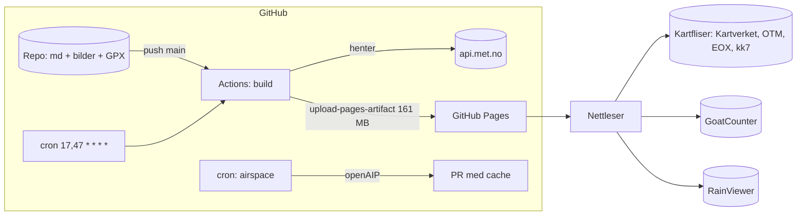
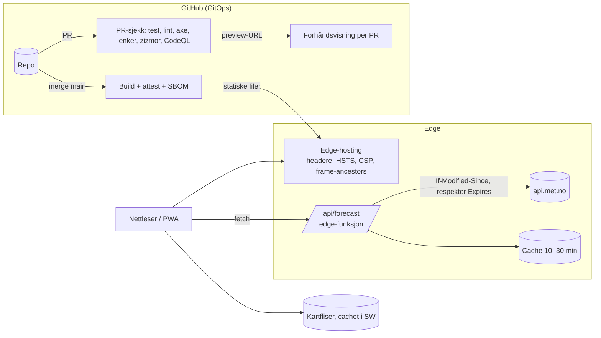

# Review av flysteder.hpgt.com

Sett fra en sky- og sikkerhetsarkitekt. Gjennomgått 16.10.2026, mot `main` på `2837c6f`.

Grunnlag: koden og historikken i repoet, workflow-kjøringene på GitHub, en lokal bygging (`npm ci`, `npm test`, `npm run build`, `npm audit`), HTTP-headerne på den publiserte siden, og skjermbilder av siden på desktop og mobil.

---

## Kort oppsummert

Dette er et uvanlig gjennomarbeidet hobbyprosjekt. Siden er statisk og har lite angrepsflate. Den har CSP uten inline-script, egne fonter og biblioteker uten CDN, og EXIF fjernes fra bildene. I CI er Actions pinnet til SHA, rettighetene er minimale, og zizmor, CodeQL, dependency review og Dependabot med cooldown er på plass. Datamodellen er godt validert, det finnes 83 tester, og dokumentasjonen er tydelig. Mange profesjonelle team ligger under dette nivået.

De største forbedringene ligger derfor ikke i grunnleggende sikkerhet, men i **arkitektur og drift**:

1. **Vindvarselet er bakt inn i byggingen, og byggingen går ikke så ofte som dere tror.** Deployen skal kjøre hvert 30. minutt, men kjørte i praksis bare **hver 2,5.–5. time** de siste dagene. «Vind nå» viser derfor ofte et varsel som er 3–5 timer gammelt, nær grensen på 6 timer.
2. **Hver bygging genererer og laster opp alle bildene på nytt:** 790 filer og 151 MB av totalt 161 MB, opptil 48 ganger i døgnet.
3. **GitHub Pages lar dere ikke sette HTTP-headere.** Dermed mangler HSTS, `frame-ancestors`, `Permissions-Policy` og en CSP som header. Det finnes heller ingen forhåndsvisning av PR-er og ingen enkel rollback.
4. **Airspace-workflowen** kjører `npm ci` med skrivetilgang til repoet og med secret tilgjengelig, og PR-ene den lager kjører ikke sjekkene.

Anbefalt retning: **behold Git som eneste sannhetskilde og Eleventy som byggverktøy, men flytt varselet ut av byggingen.** Legg det bak en liten cachende edge-funksjon, og publiser gjerne via en plattform som gir headere og forhåndsvisning av PR-er. Da trenger dere bare bygge når innholdet faktisk endres.

---

## Prioritert tiltaksliste

| # | Tiltak | Type | Innsats | Effekt |
|---|---|---|---|---|
| 1 | Flytt vindvarselet ut av byggingen (edge-proxy med cache, se [Målarkitektur](#målarkitektur)) | Arkitektur | M | Høy |
| 2 | Cache bildene i CI (`actions/cache` på `.cache`/`_site/img`) eller generer dem bare når de endres | CI/CD | S | Høy |
| 3 | ~~Del opp airspace-workflowen i en hentejobb med lesetilgang og en PR-jobb med skrivetilgang~~ Gjort, med støtte for GitHub App-token (appen må opprettes, se docs/operations.md) | DevSecOps | S | Høy |
| 4 | `npm ci --ignore-scripts` i alle workflows (ingen avhengigheter har install-script i dag) | Forsyningskjede | XS | Middels |
| 5 | ~~Legg til `/.well-known/security.txt` (RFC 9116) som peker på Report a vulnerability~~ Gjort | Sikkerhet | XS | Lav |
| 6 | Verifiser domenet `flysteder.hpgt.com` i organisasjonsinnstillingene (Pages, Verified domains), og vurder DNSSEC. CAA finnes allerede (se [Sammenligning](#sammenligning-med-andre-reviews)) | Sikkerhet | XS | Middels |
| 7 | ~~Rett lenken til `/luftrom/` i `src/_includes/site.njk:273` til `/tarn/`~~ Rettet (på engelsk ga den 404) | Feil | XS | Lav |
| 8 | Legg til lenkesjekk, HTML-validering og axe/pa11y i PR-sjekken (punkt 7 hadde blitt fanget) | Kvalitet | S | Middels |
| 9 | Byggeprovenance og SBOM (`actions/attest-build-provenance`, `anchore/sbom-action`), OpenSSF Scorecard og harden-runner | DevSecOps | S | Middels |
| 10 | PWA/offline: service worker som cacher sidene, GPX og kartfliser for området | Brukeropplevelse | M | Høy |
| 11 | Mobil: kartet først, tidslinje i stedet for knapper, og en «flyvindu»-stripe per sted (se prototypen) | Design | M | Høy |
| 12 | Én vedlikeholder til i CODEOWNERS og med admin. Slå på «Automatically delete head branches» | Styring | XS | Middels |
| 13 | ~~Ugyldige vinddata gir «Kan passe»: valider tall i `rateWind` og innfør en «ukjent»-tilstand~~ Rettet: ugyldige timer gir «Ingen varsel» | Korrekthet | S | Høy |
| 14 | Lagre METs `updated_at` i tillegg til egen hentetid, og vis begge | Datatillit | XS | Middels |
| 15 | Ikke send rå søketekst til GoatCounter (`search/no-hits/` + tekst) | Personvern | XS | Middels |
| 16 | ~~Triager `npm audit`: 9 funn i byggeavhengighetene (5 high, 4 moderate)~~ Rettet med Eleventy 3.1.7: 0 funn | Forsyningskjede | S | Middels |

XS: under 1 time · S: noen timer · M: 1–3 kvelder

---

## 1. Oppsett og arkitektur

### Slik er det i dag



### Funn

**Varselet er knyttet til byggesyklusen.** `src/_data/forecast.js` henter MET for alle 32 startsteder ved hver bygging, og resultatet bakes inn i HTML-en. Det betyr at:
- ferskheten styres av GitHubs cron, som er «best effort». Observerte kjøringer 14.–16. okt.: 12:02, 17:15, 20:45, 23:29, 01:52, 07:29, 12:52, 17:47, 21:26, 23:53, 04:36, 09:19. Det er i snitt én gang hver 4. time, ikke hver halvtime.
- GitHub slår av planlagte workflows etter 60 dager uten aktivitet i repoet. Om vinteren, når ingen endrer noe, stopper varselet stille. `isStale` skjuler da vurderingen, men brukeren ser bare «for gammelt».
- hver kjøring er en full bygging og en full Pages-deploy på 161 MB. Det gir mye støy i deploy-historikken og bruker Actions-minutter uten at innholdet er endret.
- MET ber klienter respektere `Expires` og bruke `If-Modified-Since` ([vilkår](https://api.met.no/doc/TermsOfService)). Byggingen gjør ingen av delene. Det er uproblematisk med dagens volum, men lett å rette.

**Anbefaling:** Skill innhold (endres sjelden og går gjennom Git/PR) fra data (endres hver time og har ingen review). Se [Målarkitektur](#målarkitektur).

**Bildepipelinen genererer alt på nytt hver gang.** `lib/images.js` lager 5 bredder × 2 formater for 79 bilder. Byggingen tar cirka 47 sekunder lokalt, og nesten alt er bildebehandling. eleventy-img har en egen cache, men den overlever ikke mellom kjøringer i CI.
- Raskt tiltak: `actions/cache` med nøkkel `hashFiles('src/sites/**/*.jpg', 'lib/images.js')` på eleventy-img sin cache-mappe.
- Vurder å droppe JPEG-varianten (WebP støttes overalt i dag) eller bytte til AVIF + WebP. Det halverer størrelsen.
- 2400 px-varianten brukes bare i bildeviseren. Vurder å la den ligge på 1600, eller generere den bare for oversiktsbildene.

**Hosting.** GitHub Pages er gratis og enkelt, men:
- Ingen egne headere: HSTS mangler (`curl -I` viser ingen `strict-transport-security`), `frame-ancestors` virker ikke i meta-CSP, og `Permissions-Policy`, `Cross-Origin-Opener-Policy` og `X-Content-Type-Options` kan ikke settes.
- Ingen forhåndsvisning av PR-er. Klubbmedlemmer som foreslår endringer ser ikke resultatet før det er publisert.
- Rollback betyr å kjøre deployen på nytt fra en eldre commit.

For en klubbside med lite trafikk er alt dette akseptabelt i dag. Men det er de samme begrensningene som tvinger varselet inn i byggingen.

---

## 2. CI/CD

Godt i dag:
- Rettigheter er `contents: read` som standard, og bare deploy-jobben har `pages: write`/`id-token: write`.
- `persist-credentials: false`, timeouts på alle jobber, `concurrency` på Pages.
- PR-sjekken kjører test og bygging, dependency review og zizmor. CodeQL kjører på JS og Actions.
- `FORECAST_OFFLINE=1` i PR-sjekken, så PR-er ikke spør MET.

Forbedringer:

1. **Del `build` og `deploy` etter hva som utløser dem.** Push til main gir full bygging. Varseldata hører ikke hjemme her (se Målarkitektur). Uten varselet i byggingen kan cron-jobben fjernes helt.
2. **Bildecache** som beskrevet over. Sparer ~40 sekunder og CPU per bygging.
3. **`npm ci --ignore-scripts`.** `npm query` viser at ingen av de 186 pakkene har install-script (sharp bruker ferdigbygde `@img/sharp-*`-pakker). Da stopper et kompromittert postinstall-script, som er den vanligste angrepsveien i npm.
4. **`node-version-file: .nvmrc`** i stedet for hardkodet `22` tre steder, og samme versjon lokalt.
5. **Ytelsesbudsjett:** feil PR-en hvis `_site` vokser med mer enn X MB, eller hvis forsiden blir tyngre enn Y KB. Det er billig å legge inn og fanger regresjoner.
6. **Lenkesjekk** (f.eks. `lychee` mot `_site`, bare interne lenker i PR) og **HTML-validering** (`html-validate`). Lenken til `/luftrom/` i `site.njk:273` går i dag via redirect-siden. Det fungerer, men gir et ekstra hopp og viser at slike feil ikke fanges.
7. **Tilgjengelighetstest:** `@axe-core/playwright` mot forsiden og én stedsside i PR-sjekken. Playwright kan også ta skjermbilder som artefakter, så en reviewer ser endringen uten å bygge lokalt.

---

## 3. Sikkerhet

### Siden

| Kontroll | Status | Kommentar |
|---|---|---|
| CSP | ✅ meta-tag, `script-src 'self'` | Bra. `style-src 'unsafe-inline'` er nødvendig for Leaflet. Med headere kan `frame-ancestors 'none'` og `report-to` legges til. |
| HSTS | ❌ | GitHub Pages setter det ikke for egne domener. Krever annen hosting eller en proxy foran. |
| Clickjacking | ⚠️ | `frame-ancestors` virker ikke i meta. Lav risiko, siden siden ikke har noen handlinger. |
| XSS | ✅ | `innerHTML` brukes, men alltid med `escapeHtml` eller med tall og konstanter. JSON i `<script type="application/json">` escaper `<`. Markdown kommer fra repoet (betrodd), og `markdownTemplateEngine: false` hindrer template-injeksjon. Det er riktig. |
| Tredjeparter | ✅ | Ingen tredjepartsscript. Bilder fra fliser og Yr, statistikk via GoatCounter uten cookies. |
| EXIF/GPS | ✅ | Originalene publiseres ikke. |
| security.txt | ❌ | `/.well-known/security.txt` gir 404. Legg den i `src/.well-known/` med `Contact:` som peker på advisory-lenken, og `Expires:`. |
| Domene | ⚠️ | Verifiser domenet i GitHub-organisasjonen. Det hindrer at andre tar over `flysteder.hpgt.com` hvis Pages en dag slås av. CAA-post finnes allerede, ifølge ChatGPT-reviewen (DigiCert, Let's Encrypt, Sectigo); vurder å stramme den inn til bare Let's Encrypt. |

### Repo og forsyningskjede

**Airspace-workflowen (`.github/workflows/airspace.yml`) er det svakeste punktet:**
- `contents: write` og `pull-requests: write` gjelder hele jobben, også `npm ci` og `npm run airspace`. Tokenet blir liggende i `.git/config` (bevisst, for å kunne pushe). Det betyr at kode fra en npm-avhengighet kjører med et token som kan pushe grener og lage PR-er, og med `OPENAIP_API_KEY` i miljøet.
- PR-er laget med `GITHUB_TOKEN` utløser ikke `pull_request`-workflows. Derfor må de merges med «Bypass rules». Dette er dokumentert, men i praksis betyr det at automatisk genererte data går utenom sjekkene.

Forslag:
```yaml
jobs:
  fetch:            # leser bare, kjører npm
    permissions: { contents: read }
    steps:
      - uses: actions/checkout@<sha>
        with: { persist-credentials: false }
      - run: npm ci --ignore-scripts
      - run: npm run airspace
        env: { OPENAIP_API_KEY: ${{ secrets.OPENAIP_API_KEY }} }
      - uses: actions/upload-artifact@<sha>
        with: { name: airspace, path: src/_data/cache/airspace }
  pr:               # skriver, kjører ingen tredjepartskode
    needs: fetch
    permissions: { contents: read }
    steps:
      - uses: actions/create-github-app-token@<sha>   # App med contents+PR write på dette repoet
        id: app
        with: { app-id: ..., private-key: ${{ secrets.APP_KEY }} }
      - uses: actions/checkout@<sha>
        with: { token: ${{ steps.app.outputs.token }} }
      - uses: actions/download-artifact@<sha>
      - run: git switch -c ... && git commit ... && gh pr create ...
```
Med App-token kjører PR-sjekken som vanlig, og bypass-unntaket kan fjernes fra rulesettet. Alternativt kan `peter-evans/create-pull-request` brukes med App-token.

**Videre DevSecOps-tiltak (i rekkefølge):**
1. **OpenSSF Scorecard** (`ossf/scorecard-action`) ukentlig, med resultat til Code scanning. Gir en målbar status og fanger regresjoner i oppsettet.
2. **Byggeprovenance:** `actions/attest-build-provenance` på Pages-artefaktet. Da kan dere bevise at det som ligger ute ble bygget fra en bestemt commit i denne workflowen.
3. **SBOM** per bygging (`anchore/sbom-action`), lagret som artefakt.
4. **`step-security/harden-runner`** med `egress-policy: audit` først, deretter `block` med en tillatelsesliste (registry.npmjs.org, api.met.no, github.com …). Stopper eksfiltrering fra en kompromittert pakke.
5. **Lockfile-sjekk:** alle 186 `resolved` peker i dag på `registry.npmjs.org`. `lockfile-lint --allowed-hosts npm` i PR-sjekken sørger for at det forblir slik.
6. **Kryss av sjekklisten i `SECURITY.md`.** `main` er beskyttet (bekreftet via API), men listen står som ukrysset. Kryss av det som er gjort og dater det, så den blir et revisjonsspor.

### Styring

- **Bus-faktor 1:** CODEOWNERS har én person, og det er null påkrevde godkjenninger. Få inn én til med admin (styret?), selv om merge-praksisen beholdes.
- **Gamle grener:** `claude/kind-fermi-qy2mla` ligger igjen. Slå på «Automatically delete head branches».
- **Commit-signering:** vurder «Require signed commits» i rulesettet. GitHubs web-merge signerer automatisk, så det koster lite.

---

## 4. Siden: design og brukeropplevelse

Siden er tydelig, rolig og faglig solid. «Før du starter»-boksen, retningsrosene, høydeprofilen og kildeangivelsen per felt er veldig bra. Forslagene under handler om å flytte fokus fra *oppslag* til *beslutning*.

**Forsiden, desktop.** Kartet dominerer, og det er riktig. Men:
- Venstre kolonne er nesten bare filtre. Svaret på «Hvor står vinden i dag?» ligger som en overlay oppe på kartet, og listen starter først etter ~700 px.
- Tidsvalget er fem knapper (Nå, +3 t, +6 t, I morgen). En kontinuerlig tidslinje over 48 timer gir mer og tar mindre plass.
- Når ingen steder passer, sier siden «Ingen steder kan passe», men ikke **når** det blir bedre. Det er det piloten egentlig lurer på.

**Forsiden, mobil.** Kartet havner etter søk og filtre, er bare ~200 px høyt, og listen med 32 steder blir svært lang. Forslag: kart øverst (40 % av høyden), og panelet under med svar, tidslinje og liste sortert etter vurdering.

**Stedssiden.** Veldig god på desktop. På mobil havner «Vind nå» og meteogrammet langt nede, etter kart, adkomst og start. Flytt en kompakt vindstatus og flyvinduene for 48 timer opp under tittelen. Detaljene kan ligge der de er.

**Offline.** Piloter står på toppen med dårlig dekning. En service worker som cacher stedssidene, GPX-filene og kartflisene for regionen (zoom 9–15) gjør siden brukbar uten nett. Legg også til `manifest.webmanifest`, så den kan «installeres» på hjemskjermen.

**Tilgjengelighet.** Rask sjekk: alle bilder har `alt`, én `h1`, og ingen knapper uten navn. Fargeblind-modus finnes allerede. Det er sterkt. Legg axe i CI for å holde det slik.

---

## 5. Kode og repo

- **Nettleser-JS** er skrevet som ES5-IIFE-er med globale objekter (`FlyingSites`, `FlyingSitesWind`), og flere filer er på 400–800 linjer (`home.js`, `common.js`). Det fungerer og er testbart, men gjør gjenbruk vanskelig. Neste steg: ES-moduler (`<script type="module">`), og del `common.js` i `map.js`, `i18n.js` og `theme.js`. Legg til `// @ts-check` og JSDoc, og `tsc --noEmit` i CI, uten å innføre et byggesteg.
- **Lint og format:** det finnes ingen ESLint, Prettier eller stylelint. Legg til en minimal ESLint (flat config) og Prettier, og kjør dem i PR-sjekken.
- **Validering:** `lib/validation.js` er god. Generer i tillegg et **JSON Schema** for front matter. Med `# yaml-language-server: $schema=...` øverst i stedsfilene får redaktører autofullføring og feilmarkering i VS Code, før byggingen feiler.
- **Innholdsredigering:** i dag kreves en GitHub-konto og et skjema. For klubbmedlemmer uten Git kan et Git-basert CMS (Sveltia CMS eller Decap) gi et skjema som lager PR-er. Det bevarer GitOps-flyten med PR, review og merge som publisering.
- **Språk i koden:** loggmeldinger og commit-meldinger er en blanding av norsk og engelsk, mens kommentarer og docs nå er engelske. Velg én regel og legg den i README eller CLAUDE.md, særlig siden mye av arbeidet gjøres med AI-assistent.
- **Mindre ting:** lenken til `/luftrom/` (`site.njk:273`), oppdateringer (`@11ty/eleventy` 3.1.7, `js-yaml` 5.5.0, `markdown-it` 15.0.3) som Dependabot tar neste måned, og `npm audit`. **Rettelse:** jeg kjørte først `npm audit --omit=dev`, som ga 0 funn. Men alle byggeavhengighetene er `devDependencies`, så det var feil kommando. Full `npm audit` gir 9 funn (5 high, 4 moderate), se [Sammenligning](#sammenligning-med-andre-reviews).

---

## Sammenligning med andre reviews

Det er også laget tilsvarende reviewer med Gemini, ChatGPT og Grok. Påstandene under er sjekket mot koden på `2837c6f`. «Bekreftet» betyr at jeg har reprodusert eller lest det selv.

### Funn jeg manglet, og som stemmer

| Funn | Kilde | Sjekket | Kommentar |
|---|---|---|---|
| `rateWind` gir «Kan passe» når `speed` er `undefined`, `NaN` eller en streng | ChatGPT F01 | Bekreftet: `undefined`, `NaN` og `"bad"` gir `ok`, mens `null` gir `maybe` | Det viktigste funnet jeg ikke hadde. Sammenligninger med `NaN` er alltid usanne, så alle sperrene slippes forbi. MET leverer i praksis alltid tall, men en robust ukjent-tilstand er billig, og den farlige retningen er gal grønn. |
| `npm audit` gir 9 funn (5 high, 4 moderate) | ChatGPT F05, Grok H1 | Bekreftet | Min «0 sårbarheter» var feil, fordi jeg brukte `--omit=dev`. Alle funnene er DoS i byggeverktøy (`braces` via chokidar, og `sprintf-js` via gray-matter → js-yaml 3). De når ikke besøkende, men kjører i CI. Triager, og bruk `overrides` der en fiks finnes. |
| Hentetid brukes som alder på varselet, og METs `updated_at` lagres ikke | ChatGPT F03 | Bekreftet i `forecast.js` | Lett å rette: lagre `meta.updated_at` og vis «modell oppdatert». |
| Søk uten treff sendes som rå tekst til GoatCounter | ChatGPT F08 | Bekreftet (`home.js:571`) | Tell hendelsen uten selve teksten. |
| Høydevinden (windgram) har ingen alderskontroll | ChatGPT F06 | Bekreftet: `windgram.js` bruker ikke `fetched` | Samme regel som vindvurderingen bør gjelde. |
| Oversettelser kobles til farer og luftrom etter rekkefølge | ChatGPT F11 | Bekreftet (`lib/translations.js`) | Stabile ID-er per fare, start og landing hjelper både her og for navn på startplasser i prototypen. |
| Hovedkoordinatene valideres bare som tall, uten område | ChatGPT F11 | Bekreftet. Ekstra starter sjekkes mot 5 km fra hovedstarten | Legg til en grov boks for Nord-Norge. |
| CAA-post finnes allerede | ChatGPT | Kunne ikke sjekke (DNS blokkert i mitt miljø) | Jeg anbefalte å legge den inn. Den finnes visst, så tiltaket er å stramme inn. |
| Mangler `rel="canonical"` og «hopp til innhold» | Grok L3/L4 | Bekreftet | Små ting. |
| Lenke til XCC går over `http://` | Gemini 3.2 | Bekreftet (`index.njk:125`, `site.njk:318`) | Bruk `https://` hvis xcc.no støtter det. |
| Usignerte commits | Grok M6 | Ikke sjekket | Samme anbefaling som min. |

### Der vi var enige

Alle fire peker på det samme:
- **Varselet bør ut av byggingen.** ChatGPT og jeg målte begge at cron-kjøringene kommer med 4–5 timers mellomrom.
- **Ingen HTTP-headere på GitHub Pages:** HSTS og `frame-ancestors` mangler.
- **Airspace-workflowen:** del den i en lesejobb og en skrivejobb, bruk App-token, og slutt å merge med bypass.
- **security.txt mangler.**
- **PWA og offline.**
- **Én eier i CODEOWNERS.**
- **Tidslinje på forsiden og en matrise for flyvinduer.** Gemini foreslår nesten det samme som prototypen.

### Påstander som ikke stemmer

| Påstand | Kilde | Riktig |
|---|---|---|
| Klienten henter MET direkte for 32 steder | Gemini 2.1 | Varselet hentes ved bygging (`src/_data/forecast.js`), ikke i nettleseren. Bare prototypen henter direkte. |
| Bør pinne Actions til SHA og sette `permissions: contents: read` (P1) | Gemini 4.2 | Er allerede gjort i alle workflows. |
| Aktiver Dependabot og CodeQL | Gemini 4.2 | Er allerede på. |
| CSP med `script-src https://gc.zgo.at` og `connect-src api.met.no` | Gemini 3.1 | GoatCounter-scriptet ligger på siden selv, og MET kalles ikke fra nettleseren. Forslaget ville åpnet CSP-en unødig. |
| JSON Schema/Zod-validering av `flysteder.geojson` | Gemini 4.1 | GeoJSON og KML genereres fra stedsfilene og redigeres ikke for hånd. Validering skjer allerede på kilden (`lib/validation.js`). Riktig sted å stramme inn er der, slik ChatGPT F11 sier. |
| Fem synkrone script bør få `defer` | Grok L2 | De ligger nederst i `<body>`, så `defer` gir lite. Lav verdi. |

**Samlet vurdering:** ChatGPT-reviewen er den grundigste. Den fant korrekthetsfeilen i `rateWind` og datakontrakt-problemene, som jeg overså. Grok er nøktern og stort sett korrekt. Gemini er generisk og har flere anbefalinger som allerede er gjort, eller som bygger på feil forståelse av arkitekturen.

---

## Målarkitektur

Prinsipp: **Git er sannheten for innhold, edge er sannheten for data.** Bygging skjer bare når innholdet endres.



**Konkret, i to steg:**

*Steg A (behold GitHub Pages, minst endring):*
- Lag en liten Cloudflare Worker (gratis-nivået holder godt) på `api.flysteder.hpgt.com/forecast`, som henter MET for alle steder, cacher i 15–30 minutter og respekterer `Expires`.
- Forsiden og stedssiden henter varselet med `fetch` ved lasting. `wind.js` er allerede ren logikk og kan brukes uendret.
- Legg domenet til i `connect-src`. Fjern cron fra `deploy.yml`.
- Resultat: varselet er alltid ferskt, deployer skjer bare ved endringer, og det blir ingen 60-dagers-felle.

*Steg B (når dere vil ha headere og forhåndsvisning av PR-er):*
- Flytt hostingen til **Cloudflare Workers/Pages** (eller **Azure Static Web Apps** hvis klubben heller vil ha Azure i Norway East). Begge kobles til GitHub, bygger PR-er med egen URL, har rollback med ett klikk og lar dere sette headere i en `_headers`-fil eller `staticwebapp.config.json`.
- Flytt CSP fra meta til header, og legg til `Strict-Transport-Security: max-age=63072000; includeSubDomains`, `frame-ancestors 'none'`, `Permissions-Policy: geolocation=(self), camera=(), microphone=()` og `X-Content-Type-Options: nosniff`.
- Bruk OIDC (`id-token: write`) fra Actions mot skyleverandøren i stedet for langlevde API-nøkler, hvis dere deployer fra Actions i stedet for plattformens Git-integrasjon.

Kostnad: gratis-nivået på begge plattformene dekker en klubbside med god margin.

---

## Prototype

`review/prototype/index.html` er én fil uten bygging, og laget fritt etter mine preferanser:

- **Svaret først:** én setning øverst, for eksempel «3 steder kan passe: Storlitinden, Keipen, Nona» eller «Ingenting nå. Neste vindu: Dale lørdag 08:00».
- **48-timers tidslinje** som styrer hele siden. Søylene viser hvor mange steder som passer hver time, og natt er skyggelagt etter soloppgang og solnedgang.
- **Flyvindu-stripe per sted:** 48 små ruter farget etter vurdering. Ett blikk viser *når* et sted fungerer, ikke bare *om*.
- **Listen grupperes** i Kan passe, Usikkert, Senere i perioden og Ikke nå, og sorteres etter neste vindu.
- **Kartmarkører** farget etter vurdering, med en pil for vindretningen på valgt tidspunkt.
- **Detaljvisning** med rose, flyvinduer i dagslys og en time-for-time-tabell. Den lenker videre til den fulle stedssiden for fare, landing og adkomst.
- **Live data:** steder fra den åpne `flysteder.geojson` og varsel direkte fra api.met.no. Begge tillater CORS. Varselet caches etter `Expires`, og hentingen skjer fire og fire. I produksjon bør kallene gå via edge-proxyen over. Feiler hentingen, vises tydelig merkede demodata.
- Mobil med kartet øverst og panelet under, mørk modus, tastaturstyrt tidslinje (piltaster og PageUp/PageDown), og lenkbart valg (`#storlitinden`).

Vurderingen er en forenklet kopi av `rateWind` i `src/assets/js/wind.js`, med standardgrensene fra `windRules.json`. Stedsspesifikke `max_wind` er ikke med i GeoJSON-filen, så de brukes ikke i prototypen. Prototypen er ment som en idéskisse, ikke som erstatning for siden.

### Stedsside: Sollifjellet

`review/prototype/sollifjellet.html` viser hvordan en stedsside kan se ut med samme tankegang. Den er laget mobil-først.

- **Detaljer skjult til man ber om dem:** timeskort, regelverdier og termikk ligger under «Detaljer» i værkortet, og glid til landing ligger sammenfoldet med et sammendrag på én linje.
- **Ikke «Ring tårnet» som knapp:** nummeret til Evenes tårn står bare i luftromskortet, som «Skal du over 1372 moh? Da er du inne i Evenes TMA1 og trenger klarering». En stor knapp ga inntrykk av at man alltid må ringe.
- **Status først:** et kort rett under bildet med vurdering, vind og kast for valgt time, og hvorfor.
- **Anbefalt startplass:** hver startplass vurderes mot vindretningen, og siden sier «Bruk Toppen (S, SØ, Ø)». Markørene i kartet farges likt.
- **Kompakte startplasser:** én samlet rose med vindpil og anbefalingen ved siden av. Startplasser med samme retninger slås sammen i én rad (S/SØ/Ø: Toppen, Masta), og hver rad viser retninger, navn og «Passer», «Usikkert» eller «Ikke nå». Teksten per start og en kartknapp ligger sammenfoldet under raden. Retninger som ikke passer, vises som én dempet linje. På mobil tar seksjonen omtrent halvparten så mye plass som med ett kort per start.
- **48-timers graf:** søyler for vind og kast, farget etter vurdering, med retningspiler, grenselinje og skyggelagt natt. Dra eller trykk for å velge time, og hele siden oppdateres. På mobil velger man time ved å dra sidelengs, mens loddrett bevegelse ruller siden.
- **Flyvinduer** i dagslys som knapper som hopper til tidspunktet.
- **«Før du starter»** ligger rett etter statusen og kan foldes sammen. Et enkelt flagg minner om bølge ved sterk vind fra S–SØ.
- **Luftrom som snitt:** start, landing og TMA-gulv tegnet i høyden, slik at «809 m til Evenes TMA1» er det første man ser.
- **Mobil:** toppfeltet viser navnet når man har rullet forbi bildet, seksjonsmenyen er klebrig og markerer hvor man er, og en bunnlinje har Veibeskrivelse, GPX og Kart. Kartet flyttes ikke av én finger før man har trykket på det.
- **Desktop:** to kolonner, med farer og luftrom til høyre.
- **Timeskort under grafen:** ett kort per time med statusprikk, retning, vind og kast, som kan rulles sidelengs. Tallene er lettere å lese enn søylene på mobil, og kortene velger time sammen med grafen.
- **Regelen ved tallet:** «Vind 2,4 / maks 7 m/s», «Kastforskjell 3,1 / maks 4», «Regn 0,3 mm / under 0,1» osv., med grønn, gul eller rød prikk. Man ser hvorfor vurderingen ble som den ble.
- **Termikk og skybase** for valgt time, fra Open-Meteo med samme beregning som høydevinden på dagens side (`lib/windgram.js`). Lav skybase ved start får egen merknad.
- **Ring tårnet:** knapp i bunnlinja og i luftromskortet, med nummeret fra `src/_data/towers.json`, når stedet har kontrollert luftrom over start.
- **Glid til landing** (øverst i «Landing og adkomst»): avstand, høydeforskjell og glidetall for rett linje til hovedlandingen eller SPG-landingen, og en terrengprofil med ekte høyder fra Kartverket langs linja. Profilen viser laveste klaring mellom linja og terrenget, en eksempellinje for 8 : 1 med høyden over landingen, og vinden langs linja for valgt time. Glidelinja tegnes også i kartet. Ingen farger eller grenser, siden det er en faglig avgjørelse for klubben.

Stedsdataene er kopiert inn fra `src/sites/sollifjellet/index.md` og luftrom-cachen, bildene lastes fra flysteder.hpgt.com, og varselet hentes live fra MET for 563 moh. Startplassene har fått korte navn (Toppen, Masta, Alpinbakken, Veien i anlegget, Ryggen). Det finnes ikke i stedsfilen i dag, men et `name`-felt per start ville gjort både denne visningen og kartet tydeligere.

Åpne filene direkte i en nettleser (`review/prototype/index.html` og `review/prototype/sollifjellet.html`), eller kjør `npx serve review/prototype`.
